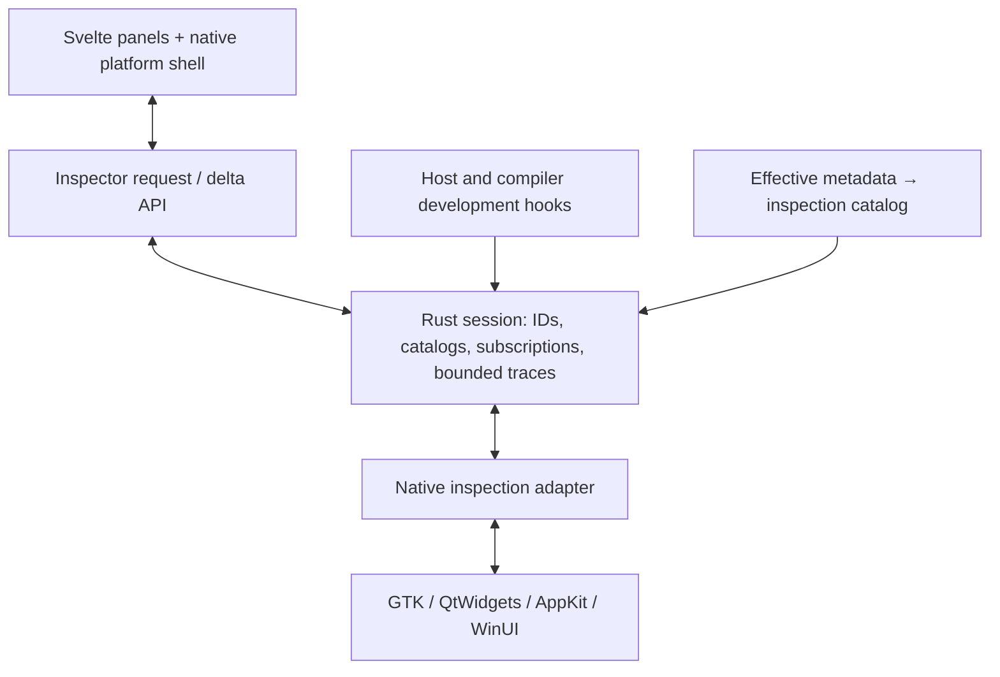

# A native inspector built with Svelters

Research and implementation proposal · October 19, 2026

## Recommendation

Build `svelters-inspector` as an optional development crate, with its panels written in Svelte/JavaScript, its session and data collection in Rust, and a small inspection adapter in each native backend. Use the inspector as a substantial application of Svelters: searchable virtual trees, typed property editors, split panes, logs, a command console, and a bounded performance timeline.

The central design choice is **metadata first, native reflection on demand**. Generate a compact inspection catalog from the same effective metadata that produces bindings. Track Svelters operations as they happen. Use native APIs to discover internal widgets, measure actual geometry, pick under the pointer, and observe changes made outside Svelters.

Start with GTK and QtWidgets, while bringing up a deliberately small inspector shell on AppKit and WinUI early. Their missing containers, scrolling and list support are valuable dogfooding work. Keep a capability matrix so all four share a data contract without pretending they expose identical native diagnostics.

This document is research, not an implemented crate. No native inspector or new performance benchmark was run for this report.

## 1. Repository baseline and evidence

Inspected public `master` at **`9a0e918ab28c88dc5047e22bf4164d7527e21873`**. A local October 18 checkout was older; conclusions below use the downloaded October 19 snapshot. Repository links are pinned to that commit.

| Existing foundation | What it gives the inspector | What still needs work |
|---|---|---|
| [Host core and operation forwarding](https://github.com/akiselev/svelters/blob/9a0e918ab28c88dc5047e22bf4164d7527e21873/crates/svelters-host/src/core/ops.rs) | Handle validation, creates, inserts, removes, writes, calls and listeners pass through one layer | Add an optional passive diagnostic sink and an ordered inspection model |
| [ABI descriptors and handles](https://github.com/akiselev/svelters/blob/9a0e918ab28c88dc5047e22bf4164d7527e21873/crates/svelters-abi/include/svelters_backend.h) | Property/method/type descriptors, enums, ranges, lifetime classes and native destruction notices | `describe` answers known IDs; it does not enumerate a complete object's members or graph |
| [ABI v2.6 observation](https://github.com/akiselev/svelters/blob/9a0e918ab28c88dc5047e22bf4164d7527e21873/plans/research/REACTIVITY.md) | Refcounted `observe(h, prop, on)` and invalidation-only `prop_changed(h, prop)` | GTK and Qt mechanics only; host batching/read-back/compare are not implemented; AppKit/WinUI leave `observe` null |
| [Compiled native runtime](https://github.com/akiselev/svelters/blob/9a0e918ab28c88dc5047e22bf4164d7527e21873/packages/native-runtime/src/index.js) | Native identity, ownership scopes, last written values, handlers, slots and child attributes | There is no complete DOM-like JS tree; component/source inspection requires explicit development hooks |
| [Virtual lists](https://github.com/akiselev/svelters/blob/9a0e918ab28c88dc5047e22bf4164d7527e21873/packages/native-runtime/src/lists.js) | Recycled rows and keyed list updates on GTK/Qt | AppKit and WinUI need an equivalent scalable presentation path |
| [Host timing and console](https://github.com/akiselev/svelters/blob/9a0e918ab28c88dc5047e22bf4164d7527e21873/crates/svelters-host/src/core.rs) | JS-entry time, host-op time/count, checkpoints and console lines | Add nondestructive subscribers; do not make the inspector consume queues that another caller expects to drain |
| [Hot reload](https://github.com/akiselev/svelters/blob/9a0e918ab28c88dc5047e22bf4164d7527e21873/crates/svelters-host/src/reload.rs) | In-process replacement with rollback on load failure | All JS state is replaced; inspector session/UI restoration must be designed explicitly |

The [current status ledger](https://github.com/akiselev/svelters/blob/9a0e918ab28c88dc5047e22bf4164d7527e21873/STATUS.md) records native CI fixes and metadata inference across all four desktop backends. The original “unverified” AppKit/WinUI milestone labels are superseded by later entries; they should not be read as the current overall status. Their API breadth remains smaller than GTK/Qt.

## 2. Product: Chrome's workflow, native toolkit vocabulary

The useful combination is Chrome's selection/editing workflow and Plasma's scriptable live environment. Plasma's [interactive console](https://develop.kde.org/docs/plasma/scripting/) is an appropriate reference for commands against running objects. [Chrome's Elements panel](https://developer.chrome.com/docs/devtools/elements) motivates selection, properties, layout overlays and listener/source navigation. [GTK Inspector](https://developer.gnome.org/documentation/tools/inspector.html) and [GammaRay](https://github.com/kdab/gammaray/wiki) are particularly relevant native references.

Suggested panels:

| Panel | Initial contents | Later depth |
|---|---|---|
| Elements | App/component hierarchy, native visual tree toggle, picker, selection, source location | Internal object graph, models, controllers, actions, buffers |
| Properties | Current native value, type, owner class, read/write status, edit/reset, observation status | Search across objects, structured value editors, custom type packs |
| Layout & Styles | Actual geometry, parent/slot attributes, Svelters classes and style inputs | Platform-specific constraints, native style metrics and provenance |
| Events | Svelters listeners and delivered events, deferred/synchronous markers | Opt-in observation of additional native signals |
| Console | Logs/errors; selected object as `$0`; commands such as `inspect`, `get`, `set`, `watch` | Application-realm evaluation and rich object results |
| Performance | Host-op counts, checkpoint/JS time, event rate, reload time | Compiler-instrumented effects, toolkit-specific rendering diagnostics |

Use native terms in the details: GTK layout managers and buffers, Qt layouts and actions, AppKit constraints and responder relationships, WinUI dependency properties and templates. A common inspector need not translate those into fictitious CSS concepts.

### Four related views, not one universal tree

1. **Svelte ownership/component graph:** component instances, branches, list items and source spans. Emit this in development builds from the compiler/runtime. It cannot be recovered reliably from toolkit reflection.
2. **Svelters insertion graph:** native handles, ordered children, named slots and child attributes. Observe successful host operations. The current core stores child → parent but does not retain complete sibling order/slot history; extend the diagnostic model rather than assuming the existing map contains it.
3. **Native visual tree:** the actual widgets/views, including toolkit-created internals and realized recycled rows. Discover lazily.
4. **Native object relationships:** nonvisual objects and references such as actions, layouts, buffers, delegates or models. Represent this as typed edges, allowing cycles and multiple parents.

Selection crosses these views through identity mappings. A virtual row's widget identity and its current logical item key must be separate; recycled views change what they represent. Accessibility is another optional view, not a substitute for these four.

## 3. Shared architecture



**JavaScript/Svelte owns presentation:** tree expansion, search input, property-editor components, selection history, filters and commands. Share those modules and view models. Use thin platform shells for native tags, split panes, tabs, toolbars and styling; existing compiler semantics preserve platform vocabulary rather than making arbitrary GTK markup portable to AppKit.

**Rust owns collection and scheduling:** identities, snapshots/deltas, metadata merging, observer refcounts, request cancellation, timestamps, bounded queues and value previews. Native object access stays on the toolkit's UI thread. Background workers may search or aggregate copied snapshots; they must not invoke arbitrary native getters.

**Adapters own the native boundary:** roots, visual children, native relationships, member discovery, value access, observation, geometry, picking and highlight presentation. GTK/AppKit/WinUI can largely use existing Rust bindings; Qt requires C++ beside its generated backend. “Mostly JS and Rust” is realistic; removing the Qt C++ layer is unnecessary.

Keep a small independent inspection-contract module so backend crates do not depend on the inspector frontend. The host exposes generic development hooks and does not depend on the inspector crate. For Qt, use a separate versioned inspection extension exported by the leaf backend, with an explicit build option; do not duplicate the backend or immediately enlarge the normal rendering ABI with every inspector function.

### Proposed data contract

These are proposed operations, not existing APIs:

```text
roots(view)
children(node, relation, cursor, limit)
describe(type, member_cursor, limit)
read(node, property_ids, preview_limits)
watch(node, property_ids) -> subscription
write(node, property, typed_value) -> normalized_value
reset_override(node, property)
pick(root, point) -> hit_stack
highlight(node, options)
trace(filter, budget) -> subscription
```

Use typed wire values and catalog IDs, with names for unknown members. Identify nodes by session, lifetime incarnation and object identity; a raw pointer or bare toolkit handle is insufficient. Responses include sequence numbers and capabilities. Native-only discoveries receive inspector IDs without becoming owned renderer objects. Unknown classes can initially expose their actual class name, nearest known ancestor and read-only supported members.

Page requests by both item count and elapsed time. A child enumeration that exceeds its deadline yields a continuation; visible expansion takes priority over background search. A full-tree search must state whether it covers only discovered nodes or is actively exploring more.

Snapshot construction and deltas need an ordering contract: capture a sequence boundary, build a consistent chunk or restart changed branches, then replay later deltas. Bound overflow must emit “resync required” rather than silently losing tree mutations. Coalescing current property state is safe; an event-history panel must retain event order until its explicit recording limit is reached.

### Identity, reload and self-inspection

Reuse existing native identity maps where possible and use weak native references for inspected objects. Holding a brief strong reference while reading a live object is different from keeping every inspected object alive. Observer registrations, native subscriptions and borrowed discoveries must release deterministically when a selection changes, a branch collapses, a root dies, or recording stops.

Tag roots and operations by origin (`application`, `inspector`, native internals). Hide inspector roots and activity by default, with an explicit self-inspection switch. Excluding self-generated queries/logs from recording prevents the inspector from endlessly reporting its own work.

For the first implementation, use **one existing backend and host**, and mount the inspector as another application-owned development root in the same JS runtime. Store session history and desired UI state in Rust, and remount the inspector after a successful full reload. Restore expanded source paths where possible, but do not pretend old native object IDs survived replacement. Failed reloads keep the previous application and its valid identities; discard only provisional objects from the failed attempt.

A permanently separate inspector JS runtime is a later host-routing change: Qt uses backend-global state and AppKit/WinUI use current-backend state, so creating another backend/host on the same UI thread is not a proven drop-in solution. A shared-thread inspector also cannot remain interactive while arbitrary application code is paused or blocked. Keep app-window quit accounting separate so an open inspector does not accidentally keep the app alive forever.

## 4. Platform implementation

### GTK 4

**Hierarchy and properties.** Walk `get_first_child` / `get_next_sibling` for a snapshot. Enumerate class properties through [`g_object_class_list_properties`](https://docs.gtk.org/gobject/class_method.Object.list_properties.html), cache by `GType`, and merge flags/types with Svelters' metadata. Use GIR and existing GI support for richer signatures. Include layout managers, layout children, event controllers, buffers and adjustments as relationships.

**Changes.** Capture Svelters insert/remove/write operations without native rescans. Watch selected properties through `notify::<canonical-name>`, compare read-back values, and detach on deselection. A notification means a value may have changed; [GObject explicitly permits identical-value notifications](https://docs.gtk.org/gobject/signal.Object.notify.html). Avoid a global signal-emission hook for `notify`: that signal disables emission hooks.

**Native internals.** [`gtk_widget_observe_children`](https://docs.gtk.org/gtk4/method.Widget.observe_children.html) creates extra bookkeeping and its documentation warns of considerable slowdown. Use it only for expanded, live native branches when needed. Release the model when the branch closes. A refreshable snapshot is a valid cheaper mode.

**Picker/highlight.** Use [`gtk_widget_pick`](https://docs.gtk.org/gtk4/method.Widget.pick.html) in root-local coordinates and `compute_bounds`/transforms for geometry. A dedicated highlight overlay must avoid consuming input or changing the selected widget's layout. Test wrapping an application root before committing to that mechanism, because it changes parentage; separate surfaces/popovers need their own roots. Skip inspector decorations during picking.

**Styles.** Show Svelters-generated rules and source provenance, native classes/state, bounds and available metrics. Full native CSS cascade explanation is a separate capability. Some useful `GtkStyleContext` metric APIs, including [padding](https://docs.gtk.org/gtk4/method.StyleContext.get_padding.html), are deprecated since 4.10; keep any GTK4-specific support behind the adapter.

**Repository work:** inspector adapter and diagnostic sink; fix/reuse detailed signal lookup; reattach forwarded observation when the target buffer/adjustment changes; generate a class inspection catalog; virtualize the flattened expanded tree with existing lists. The forwarded-observer retargeting gap is already recorded in the repo's reactivity research.

### Qt 6 / QtWidgets

**Hierarchy and properties.** Keep `QObject` ownership relationships separate from QWidget/layout structure. Layout membership is not faithfully represented by treating `QObject::children()` as the UI tree. Enumerate properties/enums/signals using [`QMetaObject`](https://doc.qt.io/qt-6/qmetaobject.html); merge the generated qdoc/override catalog for ordinary C++ getters/methods that are not metaobject-invokable. Include dynamic properties, while allowing a read-only fallback for unsupported value types.

**Changes.** Reuse the current NOTIFY relay. Add [`QMetaProperty::isBindable` / `bindable`](https://doc.qt.io/qt-6/qmetaproperty.html) where supported, and selected-object event filters for geometry, visibility, parent and style changes. Many QWidget properties have no NOTIFY signal. Expose `event-derived`, `partial`, or `manual refresh` status; reflection availability is not an observability guarantee.

`ChildAdded` can arrive before construction completes and `ChildRemoved` after destruction has begun. Queue discovery until a safe checkpoint, validate through a `QPointer`, and tolerate the object disappearing before processing. This is an explicit caveat in [`QObject::childEvent`](https://doc.qt.io/qt-6/qobject.html#childEvent).

**Picker/highlight.** Use [`QWidget::childAt`](https://doc.qt.io/qt-6/qwidget.html#childAt) within the selected top-level, plus coordinate mapping. Present a mouse-transparent highlight widget or rubber-band-style overlay; geometry tracking should be active only for hover/selection. Account for menus, popups and separate top-levels. Svelters currently uses QtWidgets; a future Qt Quick adapter would use a different visual hierarchy.

**Styles.** Show QSS input, Svelters provenance, native font/palette/geometry and public [`QStyle` metrics](https://doc.qt.io/qt-6/qstyle.html). Do not promise Chrome-equivalent computed QSS selectors through public Qt APIs; detailed native style provenance needs separate investigation or version-specific integration.

**Repository work:** put the adapter in `tools/metadata/qt/templates/` and its generator; expose an opt-in extension from `svelters-qt-build`; keep the existing leaf crate as owner of the one generated C++ backend. Add bindable/event observation after the NOTIFY-only slice. Reuse virtual lists for tree/property rows.

### AppKit

**Hierarchy and properties.** Start from application windows/content views and [`NSView.subviews`](https://developer.apple.com/documentation/appkit/nsview/addsubview(_:)). Show constraints, responder and controller relationships separately. The existing SDK-derived metadata should choose public typed accessors. [`class_copyPropertyList`](https://developer.apple.com/documentation/objectivec/class_copypropertylist(_:_:)) covers only properties declared on that class, so walk superclasses and merge/deduplicate. A property list alone is not the complete AppKit API.

**Changes.** Implement `observe` using documented KVO support plus notifications and target-action where appropriate. Apple's [KVO documentation](https://developer.apple.com/library/archive/documentation/Cocoa/Conceptual/KeyValueObserving/Articles/KVOBasics.html) explicitly cautions that framework properties are generally KVO-compliant only when documented. Text editing involves the shared field editor; programmatic assignment and user editing need separate probes. Use selected-view geometry notifications or bounded refresh where no reliable subscription exists.

**Getter boundary.** Prefer verified accessors over speculative KVC. Unknown keys can raise [`NSUndefinedKeyException`](https://developer.apple.com/library/archive/documentation/Cocoa/Conceptual/KeyValueCoding/BasicPrinciples.html). Any dynamic Objective-C calls need the project's supported exception boundary and verified encodings; Rust `catch_unwind` alone does not provide Objective-C exception handling. Never enumerate and invoke every selector as a property probe.

**Picker/highlight.** Use [`NSView.hitTest`](https://developer.apple.com/documentation/appkit/nsview/hittest(_:)) with the point in the receiver's **superview** coordinates. Normalize flipped views, backing scale and transforms in the adapter. A noninteractive sibling overlay view can draw selection bounds; it must not steal events or alter application constraints.

**Repository work:** add the KVO/notification adapter, inspection catalogs and geometry/picker support; expand metadata and bindings for scroll views, split views, tables/outlines or a reusable virtual-row list. Initial small trees can render with existing views and controls, but parity on large trees requires this list work. Auto Layout constraints deserve a native details section instead of a fabricated CSS box model.

### WinUI 3

**Hierarchy and properties.** Traverse each window content/XamlRoot using [`VisualTreeHelper.GetChildrenCount` / `GetChild`](https://learn.microsoft.com/en-us/windows/windows-app-sdk/api/winrt/microsoft.ui.xaml.media.visualtreehelper?view=windows-app-sdk-1.8). Include popups separately. Template-created visuals often appear only after loading/layout. The Svelters insertion graph remains useful before those visuals exist.

Use WinMD to generate catalogs, typed getter dispatch and dependency-property identifiers. [`IInspectable`](https://learn.microsoft.com/en-us/windows/win32/api/inspectable/nn-inspectable-iinspectable) supplies runtime class/interface information, not a generic invoke-by-property-name interface. Known WinMD members therefore still need generated dispatch. Custom controls need an optional inspector catalog/provider or show their nearest supported base.

**Changes.** Wire ABI `observe` to [`RegisterPropertyChangedCallback`](https://learn.microsoft.com/en-us/windows/windows-app-sdk/api/winrt/microsoft.ui.xaml.dependencyobject.registerpropertychangedcallback?view=windows-app-sdk-1.8), retain registration tokens and unregister them. Reuse generated DP notification machinery already present for `notify::*` events; this does not mean ABI `observe` is already wired. The repo's probes flag ActualWidth/ActualHeight as needing geometry events such as SizeChanged rather than assuming every DP callback fires.

**Picker/highlight.** [`FindElementsInHostCoordinates`](https://learn.microsoft.com/en-us/windows/windows-app-sdk/api/winrt/microsoft.ui.xaml.media.visualtreehelper.findelementsinhostcoordinates?view=windows-app-sdk-1.8) supplies a hit stack. Resolve to the relevant XamlRoot and transform bounds into its coordinates. Prefer an input-transparent overlay/composition decoration; observe size/layout only while highlighting and avoid triggering layout from the diagnostics themselves.

**Styles.** For known DPs, show effective value, local-value presence, reset via ClearValue, template parent and Svelters resource/style input. Do not equate ReadLocalValue with full value provenance. XAML diagnostics' [`GetPropertyValuesChain`](https://learn.microsoft.com/en-us/windows/win32/api/xamlom/nf-xamlom-ivisualtreeservice-getpropertyvalueschain) offers richer provenance, but the documented [diagnostics initialization](https://learn.microsoft.com/en-us/windows/win32/api/xamlom/nf-xamlom-initializexamldiagnosticsex) describes an injected diagnostics DLL and Windows.UI.Xaml. WinUI 3 compatibility/deployment needs a dedicated spike; it is not a prerequisite for an in-process inspector.

**Repository work:** extend WinMD coverage/bindings for traversal and the inspector's scrolling/split/list controls; add a generated property-to-DP table; wire observation tokens into teardown; validate on native Windows. Existing CI success does not establish arbitrary native template inspection or interactive picking behavior.

### Later platforms

UIKit and Android are research-stage backends in this snapshot, not inspector targets ready to claim parity. Their existing [UIKit](https://github.com/akiselev/svelters/blob/9a0e918ab28c88dc5047e22bf4164d7527e21873/docs/notes/ios-uikit-backend.md) and [Android](https://github.com/akiselev/svelters/blob/9a0e918ab28c88dc5047e22bf4164d7527e21873/docs/notes/android-backend.md) notes also identify a shared lifecycle/start-order change. Preserve the contract for scene/activity roots and a later companion inspector. Egui is also planned: expose logical IDs and per-frame diagnostic records rather than requiring retained native-object reflection.

## 5. Metadata strategy

Generate an inspection catalog from **the effective merged metadata**, with the same inheritance, availability and annotation precedence as bindings. Do not read repository JSON dynamically from an installed application.

Add inspection-specific facts where useful:

```text
native identity and declaring type
readable / writable / construct-only / available-on-this-version
value type, enums, flags, limits, units and bounded preview policy
observation mechanism and exact / partial / set-only / constant / none
reset semantics and whether writing bypasses an application binding
relationship kind: visual child / owned / reference / slot / layout child
getter cost class, explicit-read requirement, sensitive-value policy
provenance: ingested / inferred / manual / verified, with source link
```

Runtime reflection fills missing classes, custom objects, actual property flags and installed-version differences. Cache class descriptions once per class/version, not once per widget. Separate the inspection catalog from executable method bindings: discovering a method need not force its invocation wrapper into every binary.

Expose metadata confidence usefully: “known from SDK” and “verified by native test” are different evidence. The annotation ledger is a strong way to generate tests for observability, teardown and safe edits. It is not proof that arbitrary runtime custom classes behave identically.

## 6. Performance design and measurement

### Existing evidence, not a fresh benchmark

The repo's [reactivity research and checked-in probes](https://github.com/akiselev/svelters/blob/9a0e918ab28c88dc5047e22bf4164d7527e21873/plans/research/REACTIVITY.md) report approximately 4 µs for JS `getProp`, 3 µs for queued event delivery, and 170–200 µs for an effect rerun per event in their GTK/QuickJS release-build scenario. For 10,000 changes, batching before one job drain reduced roughly 1.7–2.0 s to 55–70 ms. Those results are workload-specific, and the batching architecture remains proposed rather than implemented on current master.

That evidence prioritizes avoiding repeated JS dispatch/effect work over optimizing a cached property-name lookup. It does not justify a new timing claim for this inspector or for the other three toolkits.

### Collection rules

1. **Feature absent:** compile diagnostic hooks and catalogs out. A closed inspector is not the same as an absent inspector.
2. **Closed but compiled in:** keep no property subscriptions, subtree observers, picker hooks, trace payloads or refresh timers. Retain only the explicitly chosen session/structural bookkeeping.
3. **Open:** send one initial bounded snapshot followed by deltas. Read visible property rows and selected geometry. Do not read every property of every node every frame.
4. **Notifications:** coalesce state invalidations by object/property; read back once, compare, then batch UI updates. Share refcounted native subscriptions with application bindings. Preserve ordinary event semantics and sync-handler ordering; do not globally merge or reorder all application events to optimize the inspector.
5. **Trees/lists:** flatten only expanded branches and virtualize their rows. Maintain sibling order incrementally. Avoid copying a 100k-item list for each keystroke or selection change.
6. **Traces:** use bounded rings with explicit dropped-event counters and resynchronization. Record op IDs/timestamps cheaply; expand arguments only when recording requests them. Inspector reads must not recursively become an unbounded trace of inspector reads.
7. **Previews:** bound strings, collection previews, nesting and bytes. A getter returning a huge native string can allocate before serialization truncates it; mark such reads explicit, or use a native length/slice API where available.
8. **Polling:** manual refresh is the default for unsupported observations. Offer slow selected-object polling explicitly, labeled sampled. Never hide global polling behind a “live” label.
9. **Frame work:** coalesce pointer movement and highlight updates to the next frame. Turn geometry tracking off when no object is hovered/selected. Avoid measuring layouts by causing new layouts.

### Proposed acceptance targets

These are initial engineering targets to validate, not measured results or compatibility promises:

| Scenario | Target/check |
|---|---|
| Inspector feature absent | No inspector catalog/assets, observers, timers or diagnostic hot-path clock reads |
| Compiled in, closed | Zero native property/tree subscriptions; aim for <1% median overhead on representative workloads |
| Open with 10k logical nodes | Initial visible chunk <100 ms; expanding a cached small branch p95 <50 ms |
| Picking | One hit-test/highlight update per frame at most; initial adapter work budget around 1 ms at 60 Hz |
| Event storm | Bounded bytes and queue length; visible drop counters; app input remains responsive |
| Detach/reload cycles | Observer/token counts and borrowed inspection references return to baseline |

Measure feature-absent, feature-present/closed, tree-only, selected-properties, picker and recording separately. Report p50/p95/p99 input/expansion latency, frame time, allocations, RSS, JS heap, native observer counts, host-op counts, queue depth and payload bytes. Measure the application regression as well as the inspector's own latency. Repeat with debug and optimized builds on each platform; toolkit versions and hardware belong in the result.

Test 1k/10k/100k logical items, fast property bursts, deep trees, recycled rows, external native edits, huge text, disappearing selections, background/foreground transitions, popups, high DPI, RTL and multiple windows. Extend the existing list stress fixtures rather than inventing a disconnected synthetic application.

## 7. Editing, console and performance semantics

Distinguish three values: the application/Svelte value, the last value Svelters requested, and the native effective value. Native clamping, inherited state and toolkit layout can make them differ.

A first property editor can perform a **transient native write**, immediately read back normalization, and clearly show that an active application binding may overwrite it. Later add an explicit temporary-override layer with per-property precedence, reset and an undo record. Reset must preserve the underlying expression/style/binding where supported; writing back an old scalar is not generally equivalent to restoring a binding. Child attributes and style setters need their own reset semantics.

The command console can initially dispatch typed inspector commands without adding a general JS evaluator. Later, schedule evaluation in the app realm at a safe checkpoint using the existing interrupt/memory controls. Never reenter a busy engine to satisfy a console request. Return bounded object previews and explicit native errors.

Element/source mapping, host timings, logs and command execution do not require a language debugger. Pausing, stepping and stack-local inspection do: `JsEngine` currently exposes no generic debugger interface. [QuickJS-NG PR #1421](https://github.com/quickjs-ng/quickjs/pull/1421) was still open when checked, and the repo's own runtime research discusses carrying a debugger patch. Keep that as a separate optional engine project. A same-thread UI also needs an explicit pause-mode event-pump design, or a separate-process frontend, to remain usable while execution is paused.

Initial performance labels must stay honest: host-op wall time includes marshaling and native calls; JS-entry wall time is not a CPU sample profiler; a frame callback is not proof of GPU presentation. Component/effect timings require new development instrumentation and should be visibly labeled as such.

## 8. Crate and build distribution

Expose one facade crate to consumers, with platform features and no toolkit dependency enabled accidentally. Package precompiled inspector UI assets/catalogs for each supported backend, built by the project's own compiler. Keep the Svelte source in the repository for development. Consumers should not need an npm install merely to attach the released inspector. Validate compiler/runtime/catalog versions together and include the selected inspector UI's native kinds in the app's backend manifest.

Conceptual consumer configuration, once a crate is published:

```toml
[dependencies]
svelters-inspector = { version = "0.1", optional = true, default-features = false, features = ["gtk"] }

[features]
inspector = ["dep:svelters-inspector"]
```

Gate attachment in Rust with `#[cfg(all(debug_assertions, feature = "inspector"))]` for a conventional development build, or permit an explicit optimized profiling build. The future CLI can enable the feature during `dev`.

Cargo `[dev-dependencies]` is sufficient for examples/tests, but not for an ordinary app binary. Cargo also does not support `cfg(debug_assertions)` as a dependency-selection mechanism; use an optional dependency/feature instead. An optimized release without that feature is the proper exclusion check. See [Cargo's dependency rules](https://doc.rust-lang.org/stable/cargo/reference/specifying-dependencies.html).

The current workspace is `publish = false` with unpublished sibling crates. Turning this into a consumable crate also requires packaging the host/ABI dependencies and build assets. Qt needs special attention because its generator currently finds scripts/metadata by walking the repository, as documented in [svelters-qt-build](https://github.com/akiselev/svelters/blob/9a0e918ab28c88dc5047e22bf4164d7527e21873/crates/svelters-qt-build/src/lib.rs). Add an out-of-repository consumer build before claiming crate distribution works.

## 9. Implementation sequence and exit criteria

| Slice | Deliverable | Exit criterion |
|---|---|---|
| I0: shared contract + tiny four-platform shells | Diagnostic sink, ordered insertion model, catalog IDs, capability reporting, one inspector window per platform | Opening/closing works; app quit and failed reload semantics remain correct |
| I1: GTK vertical slice | Tree → select → properties → one typed edit → picker/highlight → source link | Native external edit appears; disappearing selection and observer cleanup pass |
| I2: Qt same workflow | Shared panels, Qt shell, metaobject/metadata adapter, NOTIFY plus explicit fallback labels | Same contract/conformance fixtures; no second generated backend or event-filter leak |
| I3: AppKit/WinUI parity | Scrolling/virtual rows, native adapters, KVO/notifications and DP observations | Native CI plus interactive platform checks; 10k-node workflow usable |
| I4: styles, events and tracing | Provenance for Svelters rules, bounded event/operation timeline, command console | Trace overflow is visible; measured application overhead meets agreed budgets |
| I5: distribution | Feature-gated facade crate and packaged assets; external sample consumers | Fresh consumer builds outside the repo; release without inspector feature contains no inspector assets/hooks |

The first convincing demo is small: inspect the running gallery, pick a native widget, reveal its Svelte source and native internals, edit a property, watch an external native change, and keep the inspector useful across a successful or failed reload. That already exercises the core architecture much more deeply than another counter.

## 10. Decisions worth making before implementation

Recommended defaults:

1. **Main scope:** Svelters-managed applications with optional native-internals exploration. Arbitrary toolkit applications are outside the initial attachment model.
2. **First runtime model:** one host/backend; Rust session persistence and UI remount on reload. Independent inspector runtime comes after host routing is designed.
3. **Property reactivity:** reuse the existing R1a observation surface and implement the batching subset needed by the inspector, coordinated with `REACTIVITY.md`. Do not silently decide all pending application-language reactivity questions as a side effect.
4. **Unsupported observation:** explicit manual refresh; opt-in sampled watches later.
5. **Edits:** transient native edits first, a designed override layer later.
6. **Native style internals:** public APIs and Svelters provenance first; private/version-specific integration as optional capabilities.
7. **Language debugging:** separate engine feature; do not make the inspector demo wait for it.
8. **Platforms:** GTK/Qt first deep slices, AppKit/WinUI shells immediately and full vertical parity next; mobile/egui remain extensions of the contract.

The largest unresolved engineering risks are lifecycle isolation, missing large-list/container APIs on the newer backends, safe discovery of native-only objects, and accurate change observation. Generated metadata makes member discovery tractable; incremental collection and bounded delivery make the inspector practical.
