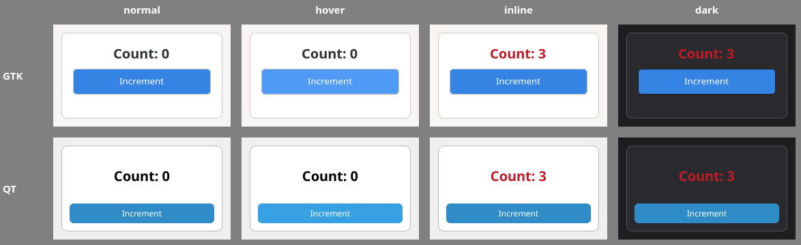

# Styling with GTK CSS and Qt stylesheets (QSS)

Status: research in progress (2026-10-17). Not a plan. Feeds the "Later: Styling" row of `PLAN.md` and builds on the sketch in `plans/archive/phases/SVR17-styling.md`.

Environment: GTK 4.22.4 + PyGObject, Qt 6.11.0 + PySide6, Xvfb. Experiments: `/tmp/claude-1000/-projects-svelters/10c0a3c6-7a5c-4d9b-9688-b5af0249a13a/scratchpad/styling/`.

## 0. Summary

- **Svelte side: solved.** With the custom renderer, `css: 'external'` works and `'injected'` is a compile error. The scoping hash is appended to each element's `class` string, so the renderer only has to forward `class`. `svelte/compiler`'s `parseCss` gives the selector AST for a translator. vite-plugin-svelte already emits a per-component CSS module that supports CSS-only HMR.
- **GTK CSS** is a real appearance engine: cascade, inheritance, `var()`, `@media prefers-color-scheme`, transitions and keyframes. It has no layout, no attribute selectors and no `:where/:is/:has`. Svelte emits `:where(.svelte-h)`, so a translator is mandatory. Providers are display-wide, and every provider load restyles everything. Classes are the cheap, local primitive.
- **QSS** is CSS syntax with brittle semantics. It has no variables or media queries. Parsing is fail-stop: one bad construct drops every following rule, and bad values clobber good ones. The nearest sheet wins regardless of specificity, and dynamic properties need a re-polish. **Setting a dynamic property named `class` breaks `.QClassName` selectors**, unless the value starts with the class name, and then `.myclass` works natively.
- **Model:** (d) layout as widget props, (a) a small validated portable vocabulary translated per backend, (b) `@native gtk|qt {}` blocks or config files as escape hatches, (c) a `--sv-*` token set mapped to GTK named colours / libadwaita variables and to `QPalette` + QSS placeholders.
- **Experiments:** the counter renders with the same intent on both backends (`img/styling-counter-gtk-vs-qt.png`). The remaining differences are theme tokens, default fonts, button chrome, transitions (GTK only) and layout stretch. Over 1000 buttons, GTK class changes are local (about 3 to 80 ms per frame) while provider changes are global (about 250 ms). Qt sheets should be set before show (36 ms vs about 900 ms after). Per-widget inline styles are the expensive path on both.

## 1. GTK4 CSS capabilities

GTK's CSS is a real CSS engine for *appearance* (it cascades, inherits, supports `var()` and animations). It has no box layout: geometry comes from layout managers and widget props.

Probe: `docs/notes/scripts/styling_gtk_parse_probe.py` loads one rule per feature into a `GtkCssProvider` and records `parsing-error`. Results are in `gtk_parse_probe.json`.

### 1.1 Properties (GTK 4.22, parser-accepted)

| Group | Accepted | Rejected ("No property named …") |
| --- | --- | --- |
| Text | `color`, `font`, `font-family/-size/-weight/-style/-variant/-stretch`, `font-feature-settings`, `font-variation-settings`, `letter-spacing`, `line-height`, `text-decoration(-color)`, `text-shadow`, `text-transform`, `caret-color`, `-gtk-secondary-caret-color`, `-gtk-dpi` | `text-align`, `white-space`, `text-overflow`, `text-indent`, `word-spacing`, `direction`, `tab-size` (they're widget props: `xalign`, `wrap`, `ellipsize`, `justify`) |
| Box | `margin*`, `padding*`, `border*` (incl. `border-image`, `border-radius`), `outline*`, `box-shadow`, `min-width`, `min-height`, `border-spacing` | `width`, `height`, `max-width`, `box-sizing`, `overflow` |
| Background | `background`, `background-color/-image/-clip/-size/-blend-mode`, gradients | — |
| Effects | `opacity`, `filter`, `transform`, `transform-origin` | `z-index`, `cursor`, `pointer-events`, `user-select`, `visibility`, `accent-color` |
| Icons | `-gtk-icon-source/-size/-style/-transform/-palette/-shadow/-filter/-weight` | — |
| Motion | `transition*`, `animation*`, `@keyframes` | — |
| Layout | — | `display`, `position`, `flex`, `gap`, `justify-content`, `align-items` |

Values: `var()` with fallback, custom properties (`--x: …`) on any node including `:root`, `calc()`, `em`/`rem`, `rgb()/hsl()/oklch()`, relative colors, `color-mix()`, plus GTK's `alpha()`, `mix()`, `shade()` and `@named` colors. Percent padding and `!important` are rejected. CSS system colors (`AccentColor`, `Canvas`, `Highlight`) are rejected.

Not diagnosed: an undefined `@named_color` or an undefined `var(--x)` without fallback parses silently and resolves to a fallback at style time (white or the inherited colour in the probe). A validator must check references itself.

### 1.2 Selectors

| Supported | Not supported |
| --- | --- |
| type (CSS name), `.class`, `#name` (`gtk_widget_set_name`), `*`, descendant, `>`, `+`, `~` | attribute selectors (`[x]`, `[x="1"]`) |
| `:hover :active :focus :focus-visible :focus-within :disabled :checked :selected :backdrop :drop(active) :link :visited :dir() :root` | `:is()`, `:where()`, `:has()`, `:not(<complex>)` (only simple `:not()`) |
| `:first-child :last-child :only-child :nth-child() :nth-last-child()`, simple `:not(.x)` | pseudo-elements (`::before`), nesting (`&`) |
| `@media (prefers-color-scheme / prefers-contrast / prefers-reduced-motion)`, `@keyframes`, `@import`, `@define-color` | `@media (min-width)`, `@supports`, `@layer`, `@property` |

`:where()` matters: Svelte emits `:where(.svelte-h)` for every compound after the first (`.a.svelte-h > button:where(.svelte-h)`). GTK rejects the whole rule, so the GTK translator must rewrite it (§3.1).

### 1.3 CSS names and nodes

Type selectors match the widget's **CSS name** (`gtk_widget_class_set_css_name`), not the GType. Internal parts are child widgets or CSS-only nodes. `gtk_css_nodes.py` instantiates all 94 concrete `Gtk*Widget` types under Xvfb and dumps the CSS name, default classes and child-node tree (`gtk_css_nodes.json`):

```text
button      -> button.text-button(label)
togglebutton-> button.text-button.toggle(label)
entry       -> entry(text)
spinbutton  -> spinbutton.horizontal(text, button.image-button.down(image), button.image-button.up(image))
scale       -> scale.horizontal(trough(highlight.top, slider))
switch      -> switch(image, image, slider)
progressbar -> progressbar.horizontal(trough.empty(progress.left))
notebook    -> notebook.frame(header.top.horizontal(tabs), stack)
listbox     -> list            expander -> expander-widget(...)    centerbox -> box
```

Of the 93 kinds that have an `element.tag` in `metadata/gtk/`, **60 have tag == CSS name and 33 differ**. Twelve CSS names are shared by several kinds: `button` covers button/togglebutton/linkbutton/lockbutton; `entry` covers entry/passwordentry/searchentry; `window` covers window/aboutdialog/assistant/shortcutswindow; and `widget` covers drawingarea/fixed/glarea. The variants are told apart by a default class (`.toggle`, `.search`, `.password`, `.link`) or not at all. The widget walk misses CSS-only nodes (`selection`, `placeholder`, `undershoot`, `check` indicators in some versions); the GTK docs' per-widget "CSS nodes" sections remain the source for those.

### 1.4 Providers, priority and per-widget scope

- `gtk_style_context_add_provider_for_display(display, provider, priority)` is the only non-deprecated way to install CSS (it lives on `GtkStyleContext` as a static function). Priorities: FALLBACK 1, THEME 200, SETTINGS 400, APPLICATION 600, USER 800.
- `gtk_widget_get_style_context()` + `gtk_style_context_add_provider()` (per-widget provider) is deprecated since 4.10 and will be gone in GTK 5. It still works in 4.22. The GTK replacement for "scope to this widget" is **a unique style class or widget name plus a display-wide rule**.
- `gtk_widget_add_css_class / remove_css_class / set_css_classes` are cheap and local (§5.2).
- `gtk_css_provider_load_from_string()` on an installed provider re-parses and **restyles every widget on the display**, as does adding or removing a provider. This is fine for HMR. It is too slow to do per inline-style change (§5.2).
- GTK 4.20+ evaluates `@media (prefers-color-scheme: dark)` and `prefers-contrast` **per provider**, from the provider's own `prefers-color-scheme` / `prefers-contrast` / `prefers-reduced-motion` properties. Changing `GtkSettings:gtk-interface-color-scheme` did not affect our provider in the probe. Setting `provider.props.prefers_color_scheme = DARK` did (`gtk_dark.py`). The host must bind these properties on every provider it creates.

### 1.5 Colors, variables, theme tokens

- `@define-color name value;` / `@name` are GTK's legacy named colours. GTK's built-in Adwaita still exports `@accent_color`, `@theme_selected_bg_color`, `@theme_fg_color` and similar names.
- Custom properties work like the web: `:root { --sv-accent: … }` and `window { --x: … }` both inherit down to a label (probe: `gtk_tokens.py`).
- **The libadwaita variables (`--accent-bg-color`, `--window-fg-color`, …) are not defined by plain GTK 4.22.** `var(--accent-bg-color)` resolved to the inherited colour without libadwaita. libadwaita 1.9 is installed here, but we don't link it. If we adopt `AdwApplication`, those variables, the system accent colour (portal) and dark mode come for free. Otherwise we define our own `--sv-*` tokens in a host-provided provider.

### 1.6 Animations and transitions

`transition` and `@keyframes`/`animation` work on any animatable property (colour, opacity, transform, padding/margin, box-shadow …), and are driven by the frame clock. `GtkCssProvider:prefers-reduced-motion` and `gtk-enable-animations` gate them. Svelte rewrites keyframe names to `svelte-h-name` consistently, so they survive translation. Svelte's own `transition:`/`animate:` directives are compile errors under the custom renderer. CSS transitions are therefore the *only* declarative motion we get on GTK for free.

### 1.7 What GTK CSS can't do

- No layout: `width`/`height`/`max-*`, `display`, flex/grid, `gap`, `position`, `overflow` are all absent. Size is `min-width`/`min-height` plus widget props (`hexpand`, `halign`, `width-request`, box `spacing`, grid row/col).
- No text alignment, wrapping or ellipsis in CSS (widget props).
- No attribute selectors, so no state can be read from arbitrary properties; only built-in pseudo-classes and classes are available.
- No per-widget inline style without the deprecated API.

## 2. Qt QSS capabilities

QSS is a CSS-*syntax* configuration language for `QStyleSheetStyle`. It is not a CSS engine: there is no inheritance by default, no variables and no media queries, and there is a fixed list of properties, each honoured only by specific widgets.

Probe: `docs/notes/scripts/styling_qss_probe.py` renders a `QPushButton` under a parent for each case and checks whether its background turned red. `qss_cascade.py` covers cascade and hover. Style is Fusion (the default on Linux without a platform theme).

### 2.1 Selectors

| Works | Doesn't |
| --- | --- |
| type `QPushButton` (matches subclasses, via `metaObject` class names), `.QPushButton` (exact class, no subclasses), `#objectName` (dashes fine: `#sv-1`), `*` | `+`, `~` (parse, but never match) |
| `[prop="v"]` on **any** dynamic or Q_PROPERTY (`[text="button"]`); `[prop~="v"]` (contains, on a space-separated QString *and* on a QStringList); `[prop\|="v"]`; `[prop]` presence; dashes in property names (`[svelte-abc="true"]`) | `[class="b"]` on a QStringList (exact match only) |
| descendant, `>` | `:not()`, `:is()`, `:where()`, `:first-child`; nesting `&` |
| `:hover :pressed :checked :disabled :focus :!checked` (negation is `:!state`), `:first/:last/:only-one` on tab-like items | `@media`, `@keyframes`, `@import`, custom properties |
| `::sub-controls` (`::indicator`, `::drop-down`, `::up-button`, `::handle`, `::groove`, `::chunk`, `::tab`, `::item`, `::menu-indicator` …) with `subcontrol-origin`/`subcontrol-position` | |

Hover works with a real pointer move (`QTest.mouseMove`). Faking `WA_UnderMouse` does not trigger it.

### 2.2 Parse failure mode, the main trap

- **Unknown properties** (`display`, `transition`) are skipped with a warning ("Unknown property display"). The rest of the rule still applies.
- **Unknown syntax** (a `--x: red` declaration, `@media`, `:not()`, `:where()`, `&`) triggers "Could not parse application stylesheet". **Parsing stops there: every rule after it is dropped, and the rules before it survive** (`qss_parsefail.py`: `QLabel{green} <bad> QPushButton{blue}` leaves the label green and the button unstyled). One unsupported construct near the top of an app's sheet therefore disables almost the whole theme. A translator must emit only syntax Qt is known to accept.
- **Unparseable values clobber instead of falling back.** `QLabel { color: var(--c) }` or `color: oklch(…)` after `QLabel { color: green }` left the label *black*, not green. CSS would have kept the earlier valid declaration. `+`/`~` selectors parse but never match.

### 2.3 Box model and per-widget honouring

QSS has a CSS-like box model per widget: margin, border, padding, then content, plus `min-/max-width/-height` and `width`/`height` for some widgets and sub-controls. Which properties are honoured depends on the widget (the Qt docs' "List of Stylable Widgets" table). Examples from the probe and docs:

- **`QPushButton { background: red; }` alone does nothing under Fusion.** QSS only takes over a button's drawing once the box is "customised" (border, or border + background). Probe: `background` and `background-color` without `border` had no effect. With `border: none` they apply. This is the classic QSS trap.
- `color`, `font*` work broadly. `background` works on QWidget subclasses only with `WA_StyledBackground` or for widgets drawn by the style (plain `QWidget` needs `paintEvent`/attribute).
- `qproperty-<name>: value` sets a Q_PROPERTY at polish time (e.g. `qproperty-iconSize`, `qproperty-alignment`). It's a one-shot write, not a binding.
- `palette(role)` values read the QPalette (`palette(highlight)`), which is how QSS reaches theme colours.

### 2.4 Cascade between app-wide and per-widget sheets

Verified in `qss_cascade.py`:

- Sheets compose along the ancestry: app sheet, then each ancestor's sheet, then the widget's own. **The nearest sheet wins regardless of specificity.** A bare `QPushButton {…}` in the widget's own sheet (or a parent's) beats `QWidget#root QPushButton#ok {…}` in the app sheet. Specificity only orders rules *within* one sheet.
- A sheet with no selector (`setStyleSheet("color: red")`) means `* {…}`: it applies to the widget **and all descendants**. A parent's `color` reached the child label, and `background` painted the label but not the button (the border trap again). That is unlike CSS inline style, which applies to one element and only inherits inheritable properties.
- There's no property inheritance in general (except font/palette propagation, when `Qt::AA_UseStyleSheetPropagationInWidgetStyles` is set).

### 2.5 Cost and re-polish

- Any `setStyleSheet` on the app or on a widget re-polishes the affected subtree: `QStyleSheetStyle` recomputes the rule set per widget and caches it per widget, keyed on class, object name and dynamic properties.
- **Changing a dynamic property does not restyle.** The widget keeps its cached rules until `style()->unpolish(w); style()->polish(w); w->update()`. The probe's "toggle all without repolish" is cheap only because it changes nothing on screen.
- Timings in §5.2. Each widget with its own sheet gets its own `QStyleSheetStyle` resolution and cache, which is the documented scaling problem of per-widget sheets.

### 2.6 No variables: palette instead

QSS has no custom properties (they break parsing; §2.2). Theming uses:

- `QPalette` (roles: Window, WindowText, Base, Text, Button, ButtonText, Highlight, HighlightedText, Accent (6.6+), PlaceholderText, Link …), set app-wide or per widget. QSS reads it with `palette(role)`.
- `QStyleHints::colorScheme()` (6.5+) and `setColorScheme()` (6.8+) for dark mode. The `colorSchemeChanged` signal triggers a re-theme.
- Static substitution at build time: resolve `var(--sv-accent)` to a literal or to `palette(accent)` while translating.

### 2.7 Fusion vs native styles

- QSS is implemented by `QStyleSheetStyle`, which wraps the current base style (Fusion, Windows, `windowsvista`/`windows11`, `macos`, or a KDE/Breeze plugin). Rules that only touch "safe" properties (`color`, `font`) keep native drawing. Once a rule touches the box (border, background, padding on many widgets), that widget's drawing switches to QSS's own generic renderer: **native look is lost for that widget**, and sub-controls must then be styled too, or they look broken (e.g. a styled QComboBox with no `::drop-down` rule).
- On macOS and Windows 11, the native styles ignore much of QSS. The Qt docs recommend Fusion for heavily styled apps. In practice a QSS-themed app runs on Fusion everywhere.

### 2.8 Why QSS is considered a trap

1. Fail-stop parsing: one unsupported token disables every rule after it, and bad values clobber good ones (§2.2).
2. Customising a box drops native rendering and requires styling every sub-control.
3. Per-widget sheets compose by proximity, not specificity, and selector-less sheets leak to descendants.
4. Dynamic-property selectors need a manual unpolish/polish.
5. Restyling is expensive: app-sheet changes re-polish everything (§5.2), and many per-widget sheets are slow and memory-heavy.
6. No variables, no media queries, no transitions; dark mode means regenerating the sheet.
7. Support is per widget and per property, documented in prose tables, not machine-readable.

The Qt community's advice is: theme with `QPalette` + Fusion, use QSS sparingly for local accents, and write a `QProxyStyle` for anything systematic.

## 3. Mapping Svelte styling onto them

### 3.1 Scoped `<style>`: the compiler already gives us what we need

Probe: `scratchpad/styling/compile_css.mjs` and `compile_css2.mjs` use the vendored fork with `experimental.customRenderer`.

- `css: 'injected'` is a compile error with a custom renderer (`incompatible_with_custom_renderer`). **`css: 'external'` works.** `compile().css.code` is the scoped stylesheet plus a source map. `cssHash` is honoured, and `css.hasGlobal` is set.
- The scoping hash is appended to the element's `class` string at compile time: `{ class: 'card svelte-5iljjr' }`, and for `class:` directives `$.set_class(label, 0, 'svelte-5iljjr', …)`. Our renderer receives `setAttribute(el, 'class', 'big svelte-5iljjr')`. **No extra plumbing is needed for scoping.** The renderer just has to stop discarding `class` (it's in `JS_ONLY_ATTRS` today, `packages/renderer/src/index.js:18`) and forward it to the host as the element's style-class list.
- Selector rewriting: `.card.svelte-h`, `label.svelte-h`, and for later compounds `button:where(.svelte-h)`. Inside `:has`/`:is`/`:not` it also scopes. Keyframes are renamed `svelte-h-name`, and unused selectors are commented out with a `css_unused_selector` warning.
- **Pruning bites native selectors.** `entry > text` (a GTK internal node) and `QPushButton` (a Qt class name) are pruned as unused, because Svelte only sees our element tags. Internal parts need `:global(...)` (`entry > :global(text)`) or the native at-rule below. Element type selectors must use **our element names**.
- The CSS parser is permissive. It accepted every GTK and QSS extension we tried: `@define-color`, `@accent`, `alpha()`, `-gtk-icon-*`, `::menu-indicator`, `qproperty-*`, `palette(highlight)`. **Unknown at-rules keep their block and are scoped** (`@backend gtk { .a {…} }` → `.a.svelte-h`). A component may have only one top-level `<style>` (`style_duplicate`), so `<style lang="qss">` *next to* a portable `<style>` needs a markup preprocessor. An at-rule inside the one `<style>` needs nothing.
- `svelte/compiler` exports `parseCss()`, which returns the same selector AST the compiler uses (`ComplexSelector` → `RelativeSelector{combinator, selectors[]}` …). A translator can be an AST walk with no third-party CSS parser. Lightning CSS is unnecessary for the prototype.
- vite-plugin-svelte already runs `css: 'external'` (`emitCss: true`) and appends `import "App.svelte?svelte&type=style&lang.css"` to the JS. In HMR mode it injects `*{}` into the style, so every node carries the hash class and **CSS-only edits don't change the JS module** (`utils/compile.js:63`). Our Vite plugin intercepts that virtual CSS module and returns JS instead (`moduleType: 'js'`): `registerStyles(id, {gtk, qt, diagnostics})` plus `import.meta.hot.accept()`. CSS-only HMR then swaps one provider or sheet and never re-mounts the component.

### 3.2 Translating scoped selectors

The prototype translator is `docs/notes/scripts/styling_translate.mjs`: about 200 lines, using the `parseCss` AST and a kinds table.

| Svelte output | GTK CSS | QSS |
| --- | --- | --- |
| `.card.svelte-h` | `.card.svelte-h` (style classes) | `.card.svelte-h` (dynamic property `class`, see below) |
| `button.primary:where(.svelte-h)` | `button.primary.svelte-h` (`:where` flattened; GTK rejects it) | `.QPushButton.primary.svelte-h` |
| type `button` / `box` / `window` | CSS name from metadata (`button`, `box`, `window`). Ambiguous kinds get a kind class: `togglebutton` → `button.sv-k-togglebutton` | exact Qt class: `.QPushButton`, `.QWidget`, `.QMainWindow` |
| `#id` | `#id` (renderer sets `gtk_widget_set_name`) | `#id` (`setObjectName`) |
| `:hover :focus :disabled :checked` | same | same. `:active` → `:pressed`, `:focus-visible` → `:focus` (warning), `:not(:x)` → `:!x` |
| `:first-child`, `+`, `~`, `:not(.x)` | native | **error** (never matches) |
| `[attr="v"]` | **error** | `[attr="v"]` (dynamic/Q_PROPERTY) |
| `:has`, `:is(a, b)`, `@media (min-width)` | error | error |
| nesting `&` | flattened by the translator | flattened |
| `@media (prefers-color-scheme: dark)` | passed through (the host binds the provider's `prefers-color-scheme`) | split into a separate *dark* sheet that the host appends |
| `@keyframes`, `transition`, `animation` | passed through | dropped with a warning |
| `var(--tok)` | passed through (GTK resolves) | `${--tok}` placeholder, substituted by the host from the token set (§3.5) |

**The Qt `class` property trap.** QSS implements `.QPushButton` as `[class~="QPushButton"]` and reads the class name through a pseudo-property named `class`. **Setting a dynamic property named `class` shadows it, and every `.QClassName` selector stops matching** (`qt_dbg.py`, `qt_dbg2.py`). There are two safe options:

- (recommended) The renderer sets `class = "<QtClassName> <user classes…>"`, e.g. `"QPushButton primary svelte-h"`. Then `.QPushButton`, `.primary` and `.QPushButton.primary.svelte-h` all work natively, and the QSS output has the same shape as the GTK output. Raw `<style>` QSS written by users also gets ordinary `.class` syntax.
- Alternatively, use a private property (`svclass`) and emit `[svclass~="x"]`. This is uglier, and users must learn it.

A separate `svelte-h="true"` dynamic property per hash isn't needed: the hash is already in the class string.

**Element type selectors** should use our element names in source, never the toolkit's. The translator maps them from metadata. The GTK mapping is lossy: 33 of 93 kinds have a CSS name different from the tag, and 12 CSS names are shared (§1.3). The renderer adds a `sv-k-<tag>` class only to kinds flagged `css.ambiguous` in metadata, so `togglebutton` doesn't match plain buttons. In Qt, the exact-class form `.QClass` avoids subclass over-match. Kinds that share a Qt class (e.g. `box` and other plain `QWidget` containers) need the same kind marker.

**Diagnostics** (compile-time, from the same AST pass; output of `node docs/notes/scripts/styling_translate.mjs docs/notes/scripts/styling_Unsupported.svelte`):

```text
warning [gtk] property 'display' dropped (unsupported in gtk)
error   [gtk] attribute selector [data-x] has no GTK equivalent
error   [gtk] pseudo-class :has unsupported
error   [gtk] ::thumb is not a known part of this element
error   [qt]  combinator '+' never matches in QSS
error   [qt]  value 'oklch(0.6 0.1 250)' for background is not understood by QSS (would clobber)
error   [qt]  custom property --local cannot be declared in QSS; put it in the token set
warning [qt]  :focus-visible approximated by :focus
warning [qt]  background on a push button needs a border in QSS; injected 'border: none'
warning [qt]  @keyframes dropped (no animations in QSS)
```

Rules: an unsupported **selector** drops the whole rule (error). An unsupported **property** drops that declaration (warning in default mode, error in `strict`). For Qt, the translator must never emit anything QSS can't parse (§2.2), so "drop and diagnose" is a correctness requirement, not polish. Diagnostics carry the backend name. A portable component should be error-free on every configured backend. Positions come from the AST `start`/`end` offsets, mapped back through `css.map`.

### 3.3 `class=` and `class:`

These arrive as one flattened string (`set class = "big card svelte-h"`; `class={{…}}` goes through `clsx`).

- GTK: `gtk_widget_set_css_classes(w, split(str))`. This is cheap and local: about 0.1 ms per call. Toggling one widget's class repaints that widget only (§5.2).
- Qt: `setProperty("class", "<QtClass> " + str)` **plus `style()->unpolish(w); style()->polish(w); w->update()`**. Without the re-polish nothing changes. Re-polish is local to the widget, and about 0.25 ms per widget in the benchmark (1000 toggles: 246 ms).
- The renderer should diff the class string and send nothing when it is unchanged. Svelte already passes the previous classes to `set_class`.

### 3.4 `style=` and `style:` (inline style)

These also arrive flattened (`set style = "font-weight: bold; color: red"`). Neither toolkit has inline style in the CSS sense.

- **GTK:** the only non-deprecated route is a per-widget class (`sv-i<handle>`) plus a rule in a display-wide provider. But *any* provider load or add restyles the whole display (§5.2: about 200 to 300 ms per 1000 buttons in software rendering), so naïve "one provider per widget" or "rewrite the shared inline provider on each change" is a scaling bug. The options, measured:
  1. **Dedupe by content.** Hash the declaration text into a class `sv-s<hash>`, keep an append-only provider of seen styles, and flush new rules at most once per frame. Changing a widget to an already-seen style is a class swap: local and cheap. Good for the common case of a few distinct values (theme states, `style:color={error ? red : null}`).
  2. **Deprecated per-widget `GtkStyleContext` provider.** It's the cheapest for apply and update in 4.22 and keeps restyling local. It will disappear in GTK 5, so use it only as an internal fast path behind the same abstraction.
  3. Continuous values (animating `style:opacity={t}`) should not go through CSS at all. Route the portable subset to widget APIs instead: `gtk_widget_set_opacity`, Pango attributes on labels, margins and `width-request` as props.
- **Qt:** per-widget `setStyleSheet(".QClass { decls }")`. It must be wrapped in the widget's exact class, because a bare declaration list leaks to all descendants (§2.4). Proximity beats specificity, so inline correctly beats component rules. Cost: about 0.3 ms per widget to apply, and every widget with its own sheet carries its own `QStyleSheetStyle` rule cache. Use it for the occasional inline style, not for 1000 rows.
- `style:` with structured values isn't available under the custom renderer (strings only), so the host parses `prop: value;` pairs. That's trivial for the portable subset.

Recommendation: treat inline `style` as a *portable-vocabulary* channel. Parse it in JS, validate it against the portable property set, then send structured setters to the host (`setStyle(el, {color, fontWeight, opacity, padding…})`). Each backend applies those natively: GTK through a dedupe class or the widget API, Qt through a widget sheet or a `QPalette`/`QFont` override. Raw toolkit CSS in `style=` is not supported.

### 3.5 Tokens and theming

One portable token set, `--sv-*`, is defined by the host per backend and per scheme.

| Token | GTK (plain GTK theme) | GTK + libadwaita | Qt |
| --- | --- | --- | --- |
| `--sv-accent` | `@accent_color` | `var(--accent-bg-color)` | `QPalette::Accent` (6.6+) |
| `--sv-accent-fg` | `white` | `var(--accent-fg-color)` | `QPalette::HighlightedText` |
| `--sv-fg` / `--sv-bg` | `@theme_fg_color` / `@theme_bg_color` | `var(--window-fg-color)` / `var(--window-bg-color)` | `WindowText` / `Window` |
| `--sv-surface` | `@theme_base_color` | `var(--view-bg-color)` | `Base` |
| `--sv-border` | `@borders` | `var(--border-color)` | `Mid` |
| `--sv-radius`, `--sv-space-*`, `--sv-font-*` | literals | literals | literals |

- **GTK:** a host-installed token provider (`:root { --sv-accent: @accent_color; … }` at `APPLICATION - 10`) with a `@media (prefers-color-scheme: dark)` block. Component CSS uses `var(--sv-accent)` unchanged. Users can override tokens with `window { --sv-accent: … }`, which inherits like on the web. A dark-mode switch means setting `prefers-color-scheme` on our providers, which restyles everything once.
- **Qt:** the host keeps each component's QSS as a *template* with `${--sv-x}` placeholders, substitutes values from the active `QPalette` and token overrides, and calls `qApp->setStyleSheet(concat)`. On `QStyleHints::colorSchemeChanged` or a palette change, it re-renders and re-sets the sheet, which is a full re-polish (§5.2: about 0.7 s apply + 0.5 s frame for 1000 buttons), acceptable for a rare event. It also sets a `QPalette` from the same token set so unstyled widgets (Fusion) match. Under Xvfb with no platform theme, `setColorScheme(Dark)` left `colorScheme()` at `Unknown` and the palette unchanged. On Linux without a platform theme, the host has to supply the dark `QPalette` itself.
- **System accent colour:** libadwaita reads it from the settings portal. Plain GTK 4.22 exposes only the theme's `@accent_color`. Qt 6.6+ fills `QPalette::Accent` from the platform theme (Windows, macOS, KDE).

### 3.6 HMR

- GTK: keep one `GtkCssProvider` per component module. A CSS HMR update calls `gtk_css_provider_load_from_string(new)` on the same provider. It's measured at about 3 ms to parse plus one full restyle (§5.2), with no widget re-creation and no state loss.
- Qt: the host keeps `Map<moduleId, qssTemplate>`, and an update replaces one entry and re-sets the concatenated app sheet. Per-widget inline sheets are untouched.
- Raw native files (`app.gtk.css`, `app.qss`) referenced from config get the same treatment through a Vite watcher.

## 4. Portable vs native: a layered model

```text
(d) widget props      layout & geometry: spacing, margins, halign/valign, hexpand, width-request,
                      xalign, wrap, ellipsize. Never CSS.
(a) portable style    <style> + class/class: + style/style:, validated against a small vocabulary,
                      translated per backend (GTK CSS / QSS / egui Style / WinUI XAML resources / AppKit)
(b) native escape     @native gtk { … } / @native qt { … } inside <style>, or app.gtk.css / app.qss in
                      config: passed through for that backend only, still scoped by Svelte, unvalidated
(c) theme             token set (--sv-*) -> GTK named colours/libadwaita vars, QPalette, egui Visuals,
                      WinUI ThemeResources, NSColor system colours; dark mode + accent come from here
```

**(a) Portable vocabulary.** Keep it deliberately small, and only what egui, WinUI and AppKit can also honour per widget:

- `color`, `background-color` (solid colours and `var(--sv-*)` only)
- `font-family`, `font-size`, `font-weight`, `font-style`
- `padding` (on widgets with a visible box)
- `border-width`, `border-color`, `border-radius`
- `opacity`
- `min-width`, `min-height`

Selectors: type (our names), class, id, descendant/child, and `:hover :active :focus :disabled :checked`. Media: `prefers-color-scheme`, `prefers-contrast`, `prefers-reduced-motion`. Named parts (`scale::slider`, `checkbutton::indicator`) map to GTK subnodes and Qt sub-controls through metadata. That is a Svelters extension, and Svelte accepts it as a pseudo-element. Transitions are "best effort": native on GTK, dropped with a warning on Qt.

**(b) Native escape hatches.** Use `@native gtk { … }` and `@native qt { … }` at-rules. Svelte keeps and scopes any unknown block at-rule; this was verified with `@backend gtk { … }`. Internal nodes and Qt class names inside them need `:global()` because of pruning. For app-wide themes, use files in config: `style: { gtk: 'theme.gtk.css', qt: 'theme.qss' }`. Native blocks skip vocabulary validation but still get the translator's syntax safety for Qt (no emitted construct that stops the parser), and their own diagnostics where the toolkit gives them: GTK `parsing-error` at load in dev, Qt's "Could not parse" message hooked through `qInstallMessageHandler`.

**(c) Theme.** Tokens plus the toolkit's own theme. For Qt this means Fusion + `QPalette` by default, because QSS on native styles is unreliable (§2.7). For GTK it is the built-in Adwaita theme, or libadwaita if adopted. Dark mode and accent colour flow from (c) into (a) through tokens, never through hard-coded colours.

**Layout stays out of CSS.** GTK has no layout properties in CSS, and Qt's are per widget and fight layouts. egui and WinUI have no CSS at all. Spacing, alignment, expand, size requests, wrapping and ellipsizing are widget props already present in metadata, typed in the `.d.ts` and diffed by the renderer. The counter experiment shows why: the same component *looked* different mainly because QVBoxLayout distributes extra height while GtkBox doesn't (§5.1), and no CSS can fix that. `margin` is the one grey area: GTK CSS has it and Qt has it per widget, but GTK widgets also have `margin-*` props. Keep it as a prop.

## 5. Experiments

Scripts are copied to `docs/notes/scripts/styling_*`. The working copies and raw results (`*.jsonl`, `shots/`) are in the scratchpad. To reproduce:

```sh
D=<outdir>; mkdir -p $D/shots
node docs/notes/scripts/styling_translate.mjs docs/notes/scripts/styling_Counter.svelte > $D/counter_translated.json
xvfb-run -a python3 docs/notes/scripts/styling_counter_gtk.py $D
QT_QPA_PLATFORM=xcb xvfb-run -a python3 docs/notes/scripts/styling_counter_qt.py $D
xvfb-run -a -s '-screen 0 1280x1024x24' python3 docs/notes/scripts/styling_gtk_bench.py <mode> 1000
```

### 5.1 Counter: the same intent in GTK CSS and QSS

`styling_Counter.svelte` is the fixture counter (window > box > label + button) with:

- a scoped `.card`, `.count` and `button.primary`;
- `button.primary:hover`;
- the tokens `var(--sv-accent)`, `--sv-accent-hover`, `--sv-surface`, `--sv-border` and `--sv-fg`;
- a 150 ms `transition`;
- inline `style="font-weight: bold"` plus `style:color={count > 2 ? '#c01c28' : null}`;
- a `@media (prefers-color-scheme: dark)` override.

It was compiled with the vendored fork (`css: 'external'`, hash `svelte-n50uah`) and translated by `styling_translate.mjs`. The Python scripts then play the renderer's role: they set class strings and apply inline style.

- GTK: a host token provider (`:root { --sv-accent: @accent_color; … }` + dark block), the component provider, and inline style as class `sv-i1` in an inline provider. Hover is forced with `GTK_STATE_FLAG_PRELIGHT`. The PNGs come from `GtkWidgetPaintable` → `gsk_renderer_render_texture`.
- Qt: the QSS template with `${--sv-*}` substituted from Fusion's `QPalette`, `class = "<QtClass> card svelte-n50uah"`, and inline style as `lbl.setStyleSheet(".QLabel { … }")`. Hover is a real `QTest.mouseMove`. Dark is the dark token set plus the `dark` sheet.



Translated output (GTK on the left; Qt is identical in shape apart from placeholders):

```css
.card.svelte-n50uah { padding: 16px; background-color: var(--sv-surface); border: 1px solid var(--sv-border); border-radius: 8px; }
.count.svelte-n50uah { font-size: 20px; color: var(--sv-fg); }
button.primary.svelte-n50uah { background: var(--sv-accent); color: var(--sv-accent-fg); border-radius: 6px; padding: 6px 14px; transition: background-color 150ms ease; }
button.primary.svelte-n50uah:hover { background: var(--sv-accent-hover); }
@media (prefers-color-scheme: dark) { .card.svelte-n50uah { border-color: #555; } }
/* Qt: .QPushButton.primary.svelte-n50uah { background: ${--sv-accent}; …; border: none; }  (border injected, transition dropped) */
```

Fidelity differences:

| Aspect | GTK | Qt | Cause, and what to do |
| --- | --- | --- | --- |
| Accent | `#3584e4` (theme `@accent_color`) | `#308cc6` (Fusion `QPalette::Accent`) | Each toolkit's own accent. This is intended: tokens follow the platform. |
| Text colour | `#2e3436` theme fg | `#000000` Fusion WindowText | Theme tokens differ. Same fix. |
| Button chrome | Adwaita's 1px border and shadow remain (no border declared) | flat, `border: none` injected | QSS needs a border to apply a background. The portable layer should normalise borders on buttons for both backends. |
| Button height and font | taller; 11pt Cantarell-like default | shorter; Fusion's smaller default font | Default fonts and min-heights differ. The portable layer should set base font tokens. |
| Vertical layout | label and button stay at natural height | QVBoxLayout spreads the label over spare height | **Layout, not CSS.** It needs `valign`/stretch props (§4). |
| Hover | animated 150 ms | instant | QSS has no transitions. |
| Inline `style:color` | per-widget class + provider | per-widget sheet | Both correct. Costs differ (§5.2). |
| Dark mode | the provider's `prefers-color-scheme` property → `@media` block applies | `setColorScheme(Dark)` was a no-op (no platform theme). The host substituted dark tokens and appended the dark sheet. | The host owns dark mode on Qt/Linux. On GTK it must set the property on each provider. |

First attempt, as a warning: with `setProperty("class", "card svelte-h")`, nothing in the Qt sheet using `.QPushButton` matched, and the inline `.QLabel {…}` sheet was ignored. That is the `class`-property shadowing trap in §3.2.

### 5.2 Applying styles to 1000 buttons

Setup: 1000 buttons in a GtkFlowBox (40 per line) or a QGridLayout (40 columns) inside a scrolled window, 1200×900, Xvfb with software rendering (llvmpipe/raster), i7-8850H. Medians of 3 runs. "apply" is the API calls. "frame" is until the next painted frame: GTK spins until the frame clock's `after-paint`, and Qt runs `processEvents` and then `grab()`. Single-widget frame numbers include any relayout of the 1000-child container that the change triggers, so read them as "what the user waits for", not pure style cost.

**GTK 4.22** (ms; full results in `gtk_bench.jsonl`, `gtk_bench100.jsonl`, `gtk_warm.jsonl`):

| Strategy | apply | first frame | change one widget: apply / frame | HMR provider reload: apply / frame |
| --- | --- | --- | --- | --- |
| baseline, no extra styling | – | steady frame 14–22 | – | – |
| shared class, one provider (`class`) | 7.6 | 255 | class add/remove: 0.1 / 3–6 | 3.4 / 239 |
| inline deduped into 10 shared classes (`dedupe10`) | 10.2 | 255 | class swap: 0.1 / 79–82 | 3.4 / 257 |
| inline: 1000 rules in one provider, reloaded per change | 196 | 375 | 157–162 / 288–317 | 3.2 / 375 |
| inline: one display provider per widget | **1751** | 646 | 2.0 / 546 | 3.3 / 585 |
| inline: deprecated per-widget `GtkStyleContext` provider | 110 | 269 | 0.1 / 72–94 | 5.9 / 263 |
| toggle the shared class on all 1000 | 4.8 | 257 | | |

**Qt 6.11, Fusion** (ms; `qt_bench.jsonl`, `qt_bench100.jsonl`, `qt_warm.jsonl`):

| Strategy | apply | first frame | change one widget: apply / frame | app-sheet reload (HMR): apply / frame |
| --- | --- | --- | --- | --- |
| app sheet set **before** show, class property | 0 | 36 (baseline 129) | | 671 / 485 |
| app sheet set after show + class property + repolish all | 587 | 327 | repolish one: 0.4 / 107 | 739 / 513 |
| sheet on the window (subtree) + class | 275 | 362 | | 1500 / 412 |
| per-widget `setStyleSheet` ×1000 (inline) | 327 | 378 | 0.3–0.4 / 168–343 | 374 / 545 |
| 1000 `#objectName` rules in the app sheet, reload per change | 383 | 476 | 538 / 452 | 653 / 372 |
| class property toggled on all 1000 **with** repolish | 246 | 148 | | |
| class property toggled on all 1000 **without** repolish | 11 | 38 (no visual change) | | |

Readings:

1. **GTK: classes are the right primitive.** Class changes are local (about 3 to 6 ms when no rule changes the look, about 80 ms when one widget really changes; the latter is dominated by relayout of the 1000-child FlowBox, and was 58 ms with 100 children). Any provider load, add or remove is global (about 240 to 260 ms for 1000 buttons here), so it's for HMR and theme switches only.
2. **GTK: one provider per inline style is quadratic** (1.75 s for 1000, because each add restyles everything). Rewriting one big inline provider per change costs about 160 ms of parsing plus a global restyle per change. **Dedupe to classes** (append-only, flushed once per frame) is the scalable design. The deprecated per-widget provider is the cheapest exact-inline path today, but it's a GTK 5 dead end.
3. **Qt: set the app sheet before widgets are shown.** Polish then happens once at show (36 ms vs 129 ms unstyled baseline, versus 587 + 327 ms when set afterwards). Every later `qApp->setStyleSheet` is a full re-polish of about 0.6 to 0.7 s plus 0.4 to 0.5 s frame per 1000 widgets. That's acceptable for HMR and dark-mode switches, but never per state change.
4. **Qt: class toggles cost about 0.25 ms per widget** (unpolish and polish), linear and local. Per-widget sheets cost about 0.3 ms each to apply, but each change re-polishes and invalidates the geometry of the parent layout (168 to 343 ms for one widget in a 1000-item grid). Inline styles on Qt should be rare. The portable inline subset should go to `QPalette`/`QFont` setters where possible.
5. HMR is feasible on both without re-creating widgets. GTK is cheap (3 ms parse + one restyle). Qt is about 1 s per 1000 live widgets in software rendering. That's fine for a dev loop, and worth batching (one `setStyleSheet` per HMR update, not per module).

## 6. Recommendation and work items

### 6.1 Recommendation

1. **Scoped `<style>` is worth supporting, as a translator, not a CSS engine.** Use Svelte's `css: 'external'` and `parseCss`, then one translator per backend that emits GTK CSS / QSS and **deterministic diagnostics**. The scoping hash rides in the `class` string, so the renderer only has to forward `class`.
2. **Class model.**
   - GTK: `class` → `gtk_widget_set_css_classes`.
   - Qt: `class` → the dynamic property `class = "<QtClassName> …"`, plus re-polish.
   - Element type selectors use our element names, mapped through metadata. Ambiguous kinds get a `sv-k-<tag>` class.
3. **A portable vocabulary first** (§4a). Everything else is opt-in native through `@native gtk|qt {}` blocks or config files. Layout never goes through CSS.
4. **Tokens, not hard-coded colours.** Use a `--sv-*` token set that the host maps to theme colours: GTK named colours (or libadwaita variables if we adopt `AdwApplication`), and Qt `QPalette` + QSS placeholders. Dark mode and accent come only through tokens. On GTK, the host binds `prefers-color-scheme` on every provider it creates.
5. **Inline `style` is a structured channel.** The renderer parses the string. The host applies it as deduped classes on GTK and as per-widget sheets or palette/font on Qt. Continuous values go to widget APIs (opacity etc.), not CSS.
6. **Qt: Fusion + palette by default, and QSS from the translator only.** Don't let user QSS bypass the syntax gate, because the fail-stop parser turns one typo into an unstyled app.

### 6.2 Work items for a styling milestone

1. **Renderer** (`packages/renderer`): stop dropping `class`/`style`/`id`.
   - Forward `class` as a class list op (diffed).
   - Parse `style` into a portable declaration map, validated in dev.
   - Forward `id` as the widget name.
   - Extend the ABI with `set_classes(h, list)` and `set_style(h, map)`, or reuse `setProp` with reserved names. Decide in `backend-abi.md`.
2. **Vite plugin** (`@svelters/build`):
   - Intercept `?svelte&type=style&lang.css`, run the translators for the configured backends, and emit `registerStyles(moduleId, {gtk, qt, darkQt})` + `import.meta.hot.accept`.
   - Surface diagnostics as Vite warnings or errors (`strict` option), with positions mapped through `css.map`.
   - Load `style: { gtk, qt }` config files the same way.
3. **Translator package** (`@svelters/style`, from `styling_translate.mjs`):
   - Selector rewriting, nesting flattening and `:where` flattening.
   - Pseudo-class map, named parts, property allowlists, Qt syntax gate, the `${--token}` template and the dark split.
   - The `@native gtk|qt {}` pass-through.
   - Golden tests over fixtures, plus the `Unsupported.svelte` diagnostics snapshot.
4. **GTK backend:**
   - A provider per style module (HMR = reload), the token provider, and an inline-style dedupe store (one append-only provider, flushed per frame).
   - Bind `prefers-color-scheme`/`prefers-contrast`/`prefers-reduced-motion` on all our providers from `GtkSettings` or the portal.
   - Log `parsing-error` in dev.
5. **Qt backend:**
   - A module → template map, token substitution from `QPalette`, `qApp->setStyleSheet` batched once per frame, and `class` property + re-polish.
   - Inline style as a `.QClass {…}` widget sheet.
   - Dark palette and dark sheet on a `colorSchemeChanged` or host setting.
   - A `qInstallMessageHandler` hook to turn "Could not parse stylesheet" into a host error.
6. **Tokens:** define `--sv-*` (colours, radius, spacing scale, font scale) and the per-backend mapping tables, plus an app-level override API (`<window style="--sv-accent: …">` or config).
7. **Screenshot tests:**
   - Promote the counter montage to an Xvfb golden test per backend.
   - Add a perf guard: 1000 class toggles under budget, and no provider churn per state change.
8. **Decide on libadwaita** for the GTK backend. It brings CSS variables, accent colour and dark mode for free, but adds a dependency and the Adwaita look.

### 6.3 What the metadata pipeline should generate

Add an optional `style` block to `svelters-element-kind/v0`, produced by ingestion plus a live probe and verified by generated tests:

```yaml
style:
  gtk:
    css_name: button                    # gtk_widget_class_get_css_name (live probe, styling_gtk_css_nodes.py)
    default_classes: [text-button]      # from the instantiated widget
    ambiguous: false                    # true when css_name is shared with another kind -> renderer adds sv-k-<tag>
    nodes: "button(label)"              # internal node tree (widgets) + doc-sourced CSS-only nodes
    parts: { }                          # portable part name -> GTK subnode path, e.g. scale.slider: "> trough > slider"
  qt:
    class: QPushButton                  # exact metaObject className used for `.QPushButton`
    subcontrols: [menu-indicator]       # from the "List of Stylable Widgets" doc table (hand-annotated, agent-filled)
    pseudo_states: [hover, pressed, checked, default, flat, open]
    box_needs_border_for_background: true
    honours: [background, border, color, font, padding, min-width, ...]
    parts: { }                          # portable part name -> Qt sub-control
  portable:
    parts: [ ]                          # e.g. scale: [slider, trough]; checkbutton: [indicator]
    pseudo: [hover, active, focus, disabled, checked]
```

Uses:

- the translator's kinds table (type selectors, parts, the push-button border rule);
- `.d.ts` typings (a `class` string, `style` as a typed portable map, and part names for editor completion through a Svelte language-server plugin later);
- generated verification tests. For each kind and part, apply `color: red` to the translated selector under Xvfb and check pixels or `gtk_widget_get_color`, exactly as `styling_qss_probe.py` does. A failing fact goes back into the annotation loop of `widget-metadata.md`.

GTK's half is fully automatable from the live probe. Qt sub-controls and "honours" exist only in prose docs, so they're agent-annotated and test-verified.
