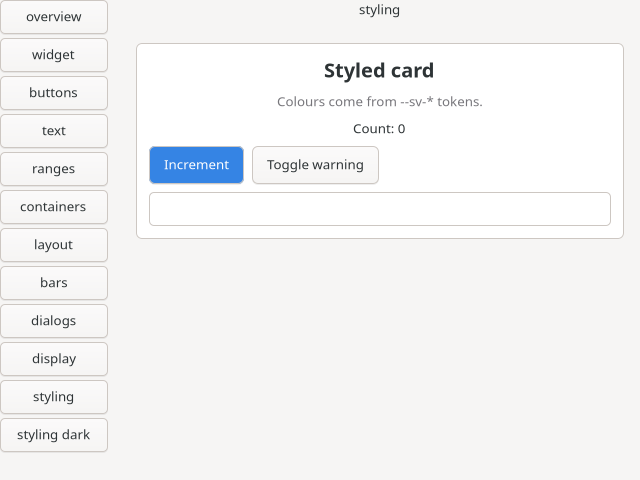
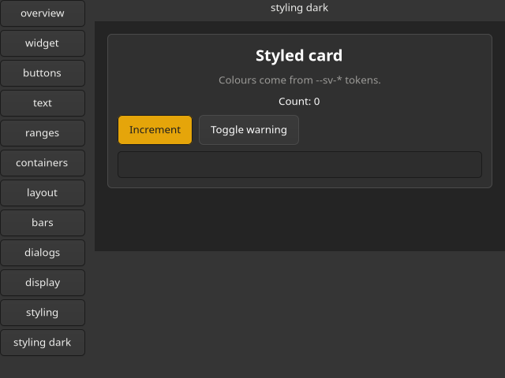
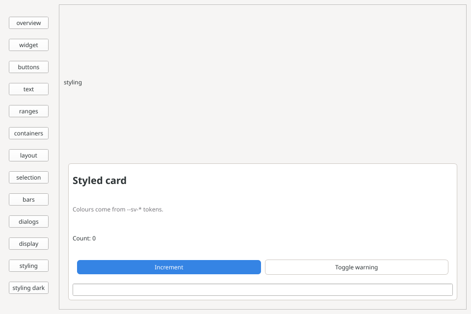
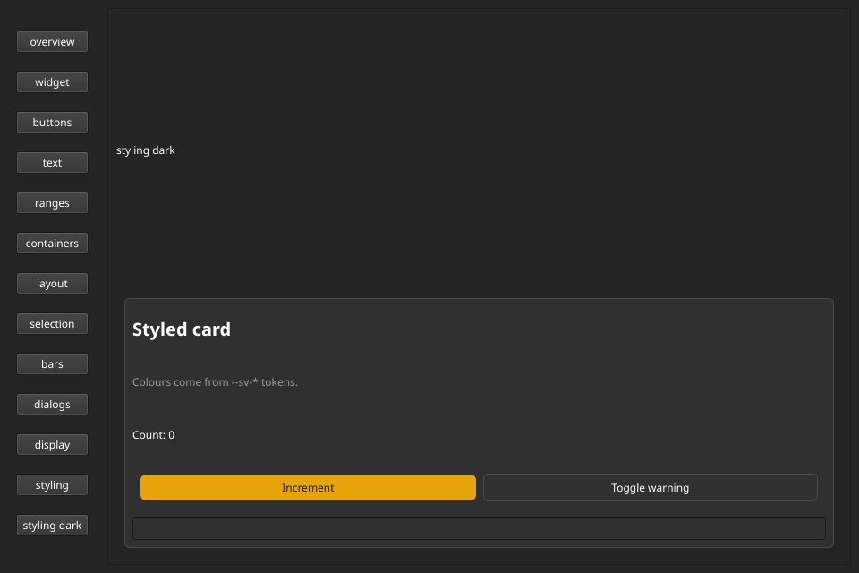

Svelte's `class`, `class:`, `style:` and `style` work on native elements, and a component's `<style>` block styles them. Every property in a declaration is one of the toolkit's own, under its native name in kebab-case, and the toolkit's style table says how it is applied: CSS properties are translated into GTK CSS or Qt stylesheets (QSS), setter properties (`spacing`, `hexpand`, `minimum-width`, ...) are written to the widget with `setProp`. The build reports everything it had to drop, naming the toolkit. Colours and sizes can come from `--sv-*` tokens that switch with the colour scheme at runtime.

```svelte
<script>
  import { setColorScheme, setTokens } from '@svelters/native-runtime/style';
  let count = $state(0);
  let warn = $state(false);
</script>

<box class="card" orientation="vertical" spacing="8">
  <label class="count" class:warn style:font-weight={count > 2 ? 'bold' : null}>Count: {count}</label>
  <button class="primary" onclicked={() => count++}>Increment</button>
  <button onclicked={() => setColorScheme('dark')}>Dark</button>
  <button onclicked={() => setTokens({ '--sv-accent': '#e5a50a' })}>Amber accent</button>
</box>

<style>
  .card { background-color: var(--sv-surface); border: 1px solid var(--sv-border); border-radius: var(--sv-radius); padding: var(--sv-space-3); }
  .count.warn { color: var(--sv-danger); }
  button.primary { background-color: var(--sv-accent); color: var(--sv-accent-fg); border-radius: 6px; padding: 6px 14px; }
  button.primary:hover { background-color: var(--sv-accent-hover); }
  @media (prefers-color-scheme: dark) { .card { border-color: #666; } }
</style>
```

This is the GTK vocabulary; the Qt version of the component writes `<box-layout class="card" direction="top-to-bottom">`, `<push-button>` and `push-button.primary`, since element names are each toolkit's own. The component, light and dark, on both toolkits (the `styling` and `styling dark` pages of the widget galleries):

| | Light | Dark |
| --- | --- | --- |
| GTK 4 |  |  |
| Qt 6 |  |  |

The Qt window stretches the page vertically because `QVBoxLayout` distributes spare height; that is layout, which CSS never controls (see [How each platform styles](#how-each-platform-styles)).

## Four layers

| Layer | What | Where |
| --- | --- | --- |
| Native styling | `<style>`, `class`, `class:`, `style:`, `style` with the toolkit's CSS properties | translated to GTK CSS and QSS |
| Setter properties | the same places, with the toolkit's layout and widget properties (`spacing`, `hexpand`, `width-request` on GTK; `spacing`, `minimum-width`, `stretch` on Qt) | written with `setProp` / `setChildAttr`, matched at compile time |
| Native escape | `@native gtk { }` and `@native qt { }` inside `<style>` | passed through verbatim to one toolkit |
| Tokens | `--sv-*` custom properties and the colour scheme | one token set mapped per toolkit |

Widget props set as attributes (`<box spacing={8}>`) still work and win over any style.

## How it works

```text
<style> in App.svelte
  | Vite plugin (@svelters/native-runtime/vite):
  |   CSS declarations: stock Svelte compile (css: 'external') scopes the selectors,
  |                     @svelters/style translates them for the toolkit
  |   setter declarations: svelters-compile matches them to elements at compile time
  v
registerStyles("src/App.svelte", { gtk } | { qt, qtDark })   (data in the bundle, no <style> tag)
generated code: setProp / setChildAttr for setter rules, conditional on dynamic class / id
  v
runtime: class / id / style -> host.style(op, handle, text)      (ABI v2.3)
  v
GTK: one GtkCssProvider per component, widget css classes          Qt: one application stylesheet, class property
```

- **Scoping.** Svelte appends a scope class (`svelte-<hash>`, derived from the file path) to every selector, and the compiler adds it to every native element of the component, so a component's rules only match its own elements.
- **Type selectors use Svelters element names** (`button`, `label`, `entry`), not toolkit names. Each toolkit has its own element names, and the translator maps them: `button` becomes the CSS node `button` on GTK, `push-button` becomes `.QPushButton` on Qt. Kinds that share a toolkit name with another kind (for instance `button`, `toggle-button` and `link-button` are all the CSS node `button`) get a marker class `sv-k-<tag>` from the runtime, and the selector uses it, so `button` never matches a toggle button. An element that does not exist on a toolkit (`toggle-button` on Qt) drops the rule there with a warning.
- **Classes are cheap and local.** GTK adds and removes only the classes the app set (the widget keeps its own `text-button` or `toggle`). Nothing writes the whole `css-classes` list. Qt sets the dynamic property `class` to `"<QtClass> your classes"`, so `.QPushButton` keeps matching, and re-polishes that one widget.
- **`id`** sets the widget name (GTK) or object name (Qt), so `#id` selectors match.

## How each platform styles

Each toolkit has a table, generated from `metadata/style/<toolkit>.yaml` and checked against the toolkit's metadata (a setter must be a writable property of every element it applies to). The reference pages list every property: [GTK 4](/api/styling/gtk/), [Qt 6](/api/styling/qt/).

- **GTK 4.** GTK CSS styles the widget's CSS nodes (`button`, `entry > text`, `scale > trough`) and its classes. Layout is not CSS in GTK: spacing, expansion, alignment and size requests are `GtkWidget` and container properties, so they are setter properties under their GObject names (`width-request`, `hexpand`, `halign`, `margin-start`, `spacing`). GTK CSS keeps `min-width` and `min-height` (a CSS minimum) and the CSS box `margin`; `margin-top` and `margin-bottom` are the widget margins, like `margin-start` and `margin-end`.
- **Qt 6.** QSS styles widgets by class (`.QPushButton`) and the dynamic `class` property. Layout belongs to `QLayout`: `spacing`, `direction` and `contents-margins` are setters on `box-layout`, and a child's `stretch` and `alignment` in its layout are child attributes of the parent (the same as `parent:stretch`). `minimum-width`, `maximum-height` and friends are the `QWidget` properties; `min-width` is the QSS one.
- **Planned toolkits.** WinUI 3 and UIKit have no stylesheet language Svelters can target, so their tables will be setters only (`dialect: none`), and their setter rules take element names, `.class` and, where the platform supports it, `#id`.

Names are never translated between toolkits: `minimum-width` on GTK is reported as a Qt property, not mapped to `width-request`. A component that targets both toolkits writes both names; each toolkit applies its own and warns about the other's.

## Setter rules

A rule whose declarations include setter properties becomes a setter rule for those properties; its CSS declarations still go to the stylesheet.

```svelte
<box class="toolbar" class:dense>
  <button class="grow">Save</button>
</box>

<style>
  .toolbar { spacing: 8px; orientation: horizontal; color: var(--sv-fg); }
  .toolbar.dense { spacing: 2px; }
  .grow { hexpand: true; }          /* GTK */
  .grow { stretch: 1; }             /* Qt: a child attribute of the box */
</style>
```

- **Selectors.** One compound of an element name, `.class` and `#id`. A combinator (`.toolbar .grow`), a state (`:hover`), `@media` or a nested rule around a setter property is an error naming the property: the toolkit has no way to re-evaluate them, so they stay CSS-only.
- **Matching.** The compiler matches setter rules at compile time. A rule that depends on a dynamic `class`, a `class:` directive or a dynamic `id` becomes a runtime condition, so toggling the class switches the value. Only changes are written.
- **Precedence.** An explicit attribute (`<box spacing={4}>`) wins over `style:` and `style=`, which win over rules; rules are ordered by specificity (ids, classes, element names), then source order; the native value is last. Removing the attribute or the inline declaration brings the next layer back.
- **Restoring.** When no rule, inline declaration or attribute sets the property any more, the spec's native default is written back; for a property without a known default, the runtime reads the value with `getProp` before the first override and writes that back. A child attribute goes back to `null` (the parent's default). `style:<setter>={undefined}` falls back to the static `style=` value, then the rules, then the default.
- **Values.** Lengths are unitless or in `px`; booleans are `true` and `false`; enumerations are the property's own values (`halign: center`); `contents-margins` takes 1 to 4 lengths in CSS order. `var()` is not available in setter properties.
- A rule that matches an element its property does not apply to (`.toolbar { spacing: 8px }` on a label) skips that property; with an element name in the selector it is an error at build time.

### GTK setter properties

| Property | Applied through | Applies to |
| --- | --- | --- |
| `column-homogeneous` | setter `column-homogeneous` | `Gtk.Grid` |
| `column-spacing` | setter `column-spacing` | `Gtk.Grid`, `Gtk.FlowBox` |
| `halign` | setter `halign` | `Gtk.Widget` |
| `height-request` | setter `height-request` | `Gtk.Widget` |
| `hexpand` | setter `hexpand` | `Gtk.Widget` |
| `homogeneous` | setter `homogeneous` | `Gtk.Box`, `Gtk.FlowBox` |
| `justify` | setter `justify` | `Gtk.Label` |
| `margin-bottom` | setter `margin-bottom` | `Gtk.Widget` |
| `margin-end` | setter `margin-end` | `Gtk.Widget` |
| `margin-start` | setter `margin-start` | `Gtk.Widget` |
| `margin-top` | setter `margin-top` | `Gtk.Widget` |
| `orientation` | setter `orientation` | `Gtk.Orientable` |
| `row-homogeneous` | setter `row-homogeneous` | `Gtk.Grid` |
| `row-spacing` | setter `row-spacing` | `Gtk.Grid`, `Gtk.FlowBox` |
| `sensitive` | setter `sensitive` | `Gtk.Widget` |
| `spacing` | setter `spacing` | `Gtk.Box` |
| `valign` | setter `valign` | `Gtk.Widget` |
| `vexpand` | setter `vexpand` | `Gtk.Widget` |
| `width-request` | setter `width-request` | `Gtk.Widget` |
| `wrap` | setter `wrap` | `Gtk.Label` |
| `xalign` | setter `xalign` | `Gtk.Label` |
| `yalign` | setter `yalign` | `Gtk.Label` |

### Qt setter properties

| Property | Applied through | Applies to |
| --- | --- | --- |
| `alignment` | child attribute `alignment` | `box-layout` |
| `contents-margins` | setter `contents-margins` | `box-layout` |
| `direction` | setter `direction` | `box-layout` |
| `enabled` | setter `enabled` | `QWidget` |
| `maximum-height` | setter `maximum-height` | `QWidget` |
| `maximum-width` | setter `maximum-width` | `QWidget` |
| `minimum-height` | setter `minimum-height` | `QWidget` |
| `minimum-width` | setter `minimum-width` | `QWidget` |
| `spacing` | setter `spacing` | `box-layout` |
| `stretch` | child attribute `stretch` | `box-layout` |

## `style` and `style:`

Inline style is split the same way: CSS declarations are sent to the backend in its dialect, setter declarations are written with `setProp` above every rule. Raw toolkit CSS is not accepted in `style`; use `@native`.

- `style:spacing={8}` and `style="spacing: 8px"` take the same path. A number or boolean is written as it is; a string is parsed like a declaration value.
- GTK deduplicates CSS by content: each distinct declaration set becomes a shared class `sv-s<n>` in one append-only provider, flushed once per main-loop turn. Changing a widget to an already seen style is a class swap. Inline rules sit above component rules, as inline style does on the web.
- Qt gives the widget its own stylesheet, wrapped in the widget's exact class (a bare declaration list would leak to its descendants).
- `opacity` in `style` never goes through CSS: it is `gtk_widget_set_opacity` on GTK and a `QGraphicsOpacityEffect` on Qt, which is also why Qt supports `opacity` only inline.
- Several `style:` directives that change in one update arrive as one operation.

Continuously animated values (`style:opacity={t}` every frame) are better driven through props or `opacity`; every new distinct style string is a new GTK class, and a Qt widget sheet re-polishes its widget.

## Selectors

For CSS properties (setter properties take one compound of element name, `.class` and `#id`, see [Setter rules](#setter-rules)):

| Selector | GTK | Qt |
| --- | --- | --- |
| element name, `.class`, `#id`, `*` | yes | yes |
| descendant and child (`a b`, `a > b`) | yes | yes |
| `:hover`, `:focus`, `:disabled`, `:checked` | yes | yes |
| `:active` | yes | becomes `:pressed` |
| `:focus-visible` | yes | approximated by `:focus` (warning) |
| `:first-child`, `:last-child`, `:only-child`, `:focus-within`, `:backdrop`, `:selected` | yes | `:selected` only; the rest is an error |
| `:not(.x)` | yes | `:not(:state)` becomes `:!state`; otherwise an error |
| `+`, `~` | yes | error (QSS parses them but they never match) |
| `[attr]` selectors, `:is()`, `:has()`, `::part`, nesting `&` outside Svelte's output | error | error |
| `@media (prefers-color-scheme: dark)` | yes | yes (a dark sheet appended while the dark scheme is active) |
| `@media (prefers-contrast)`, `(prefers-reduced-motion)` | yes | error |
| `@keyframes` | yes | dropped with a warning |

An unsupported selector drops the whole rule and reports an error. Svelte's own `:where(.svelte-h)` on later compounds is flattened, because GTK rejects the whole rule otherwise.

## CSS properties

The CSS properties of each toolkit are listed in its reference page ([GTK 4](/api/styling/gtk/), [Qt 6](/api/styling/qt/)). A name that is not in the toolkit's table is dropped with a warning that names the toolkit, says when another toolkit has it, and suggests the closest names (`width` on GTK: `width-request`, `border-width`, `min-width`).

Values are checked per toolkit. Qt is strict because QSS clobbers earlier declarations with a value it cannot parse: `oklch()`, `color-mix()`, `calc()`, `rem` units, percentages, gradients and `!important` are errors there. GTK rejects `!important` and percentage padding.

Two compensations are applied for you:

- **Qt boxes.** A QSS background on a button, combo box or spin box only paints once the box is customised, so `border: none` is added to a rule that sets a background but no border (not on labels, frames and windows).
- **GTK themes.** The theme paints buttons and entries with a `background-image` gradient that hides `background-color`, so `background-image: none` is added next to it.

## Diagnostics

Setter declarations are checked by the compiler: an unknown property, a bad value, or a combinator, state, `@media` or nesting around a setter property is a compile error with its position.

CSS declarations are checked by the translator. Each dropped construct is one Vite warning from the compiler plugin (`svelters-native-compiler`), naming the toolkit:

```text
warning [qt] property 'box-shadow' is not supported on qt
warning [qt] <toggle-button> is not an element on qt; rule dropped
error [qt] value 'oklch(0.6 0.1 250)' for background-color uses 'oklch', which QSS cannot parse
error [qt] combinator '+' never matches in QSS; rule dropped
```

Translator errors are reported as warnings too: the rule is dropped and the build continues. Nothing is dropped silently. Build all targets from one source and read the output of each toolkit; a component that is clean on every toolkit you ship prints nothing. If stock Svelte cannot compile a component for its CSS, the plugin warns `<style> not translated` and skips the CSS half. Inline `style` problems are reported once per distinct message at runtime with `console.warn`.

There are no style options in `svelteConfig`.

## Tokens and the colour scheme

`--sv-*` tokens are the portable way to pick colours and sizes. The defaults come in a light and a dark set:

| Token | Light | Dark |
| --- | --- | --- |
| `--sv-bg` | `#f6f5f4` | `#242424` |
| `--sv-fg` | `#2e3436` | `#ffffff` |
| `--sv-surface` | `#ffffff` | `#303030` |
| `--sv-border` | `#cdc7c2` | `#4a4a4a` |
| `--sv-accent` | `#3584e4` | `#3584e4` |
| `--sv-accent-hover` | `#1c71d8` | `#4a90e8` |
| `--sv-accent-fg` | `#ffffff` | `#ffffff` |
| `--sv-muted` | `#77767b` | `#9a9996` |
| `--sv-danger` | `#c01c28` | `#ff7b63` |
| `--sv-radius` | `6px` | `6px` |
| `--sv-space-1` to `--sv-space-4` | `4px`, `8px`, `12px`, `16px` | same |
| `--sv-font-size`, `--sv-font-family` | `11pt`, `sans-serif` | same |

```js
import { setTokens, getTokens, setColorScheme, getColorScheme } from '@svelters/native-runtime/style';

setColorScheme('dark');                       // tokens, Qt palette, GTK prefers-color-scheme and dark sheets follow
setTokens({ '--sv-accent': '#e5a50a' });      // override app-wide
setTokens({ '--sv-accent': null });           // back to the scheme's default
```

Calls in the same job are batched, and a token set that did not change sends nothing.

- **GTK.** Tokens are a `:root { --sv-x: value; }` rule in one small provider below the component providers. Component CSS keeps `var(--sv-x)` and GTK resolves it, so a token change rewrites that one provider. The scheme is set as the `prefers-color-scheme` property of every provider the host owns (GTK evaluates `@media (prefers-color-scheme)` per provider) and as the toolkit's dark preference, so the theme's own widgets follow too.
- **Qt.** QSS has no variables. The translator keeps component rules as templates with `${--sv-x}` placeholders; the runtime fills them from the active token set and the backend concatenates the sheets into one application stylesheet. The same tokens become the application `QPalette` (`--sv-bg` is Window and Button, `--sv-fg` the text roles, `--sv-surface` is Base, `--sv-accent` and `--sv-accent-fg` are Highlight and HighlightedText), so widgets you did not style match. A token without a value and without a `var()` fallback removes its declaration rather than emitting something QSS would mis-parse. Qt sets the sheet at once while no window is visible (startup) and one zero-delay timer turn later after that, so a theme switch is one re-polish.
- Tokens are app-wide on both toolkits. A per-subtree override works on GTK only through `@native gtk`.
- `@media (prefers-color-scheme: dark)` in a component follows `setColorScheme`, not the operating system. Following the system setting is an open item.
- Dark mode on Qt under X11 without a platform theme is the palette above: `QStyleHints::setColorScheme` did not change it in testing, so Svelters does not rely on it.

## `@native`

`@native gtk { }` and `@native qt { }` inside `<style>` are passed to that toolkit only, as written, after the translated rules:

```svelte
<style>
  .field { color: var(--sv-fg); }

  @native gtk {
    entry > text { color: red; }
    button.text-button:hover { box-shadow: inset 0 0 0 1px @accent_color; }
  }

  @native qt {
    .QLineEdit { selection-background-color: ${--sv-accent}; }
    QPushButton::menu-indicator { image: none; }
  }
</style>
```

- Nothing in a native block is validated or scoped to the component: Svelte would prune the toolkit's own selectors (`entry > text`) as unused, so the blocks are lifted out before the compile. Use your own classes to limit them.
- Qt token placeholders (`${--sv-accent}`) are filled; everything else is verbatim, and QSS stops parsing at the first construct it does not understand, so a typo in a Qt block can disable every rule after it.
- GTK reports a native block's parse errors on stderr (`[svelters-gtk] css parse error`).
- Use native blocks for internal nodes (`entry > text`, `scale > trough > slider`), Qt sub-controls (`::indicator`, `::handle`), gradients, shadows and anything outside the style tables. Setter properties have no place in them.

## Performance notes

- A class change costs a class change: GTK about 3 to 6 ms for 1000 buttons when no rule changes the look, Qt about 0.25 ms per widget for the re-polish.
- Providers and the Qt application stylesheet are the expensive path (about 240 ms on GTK and 0.7 s on Qt per 1000 widgets, software rendering). They are used for sheet registration, hot reload and token or scheme changes, never per interaction.
- The Qt sheet is applied before the first window is shown (36 ms against about 900 ms after, measured over 1000 buttons).
- Hot reload (`svelters-build --watch`) re-registers sheets under the same ids, which reloads one GTK provider or one Qt sheet.

Measurements (taken on the since-retired renderer pipeline; the backend side is unchanged): `docs/notes/styling-gtk-css-qss.md`.

## Limits and open items

- Parts (`scale::slider`, `check-button::indicator`) are not in the style tables yet; use `@native`.
- No libadwaita: tokens are literal values on both toolkits, so the system accent colour is not followed.
- The scheme is chosen by the app, not read from the system.
- Svelte's `transition:` and `animate:` stay compile errors; CSS `transition` works on GTK only.
- Unscoped `@native` content is global to its toolkit.

Sources: `docs/notes/styling-gtk-css-qss.md`, `docs/notes/x6-styling.md`, `docs/notes/st1-style-unification.md`, `docs/notes/fx1-fixes.md` (item 1), `docs/notes/native-compiler/styling-syntax.md`, `packages/native-runtime/vite.js`, `packages/native-runtime/src/style.js`, `plans/milestones/X6-styling.md`, `plans/milestones/ST1-style-unification.md`, `plans/architecture/backend-abi.md` (ABI v2.3).
