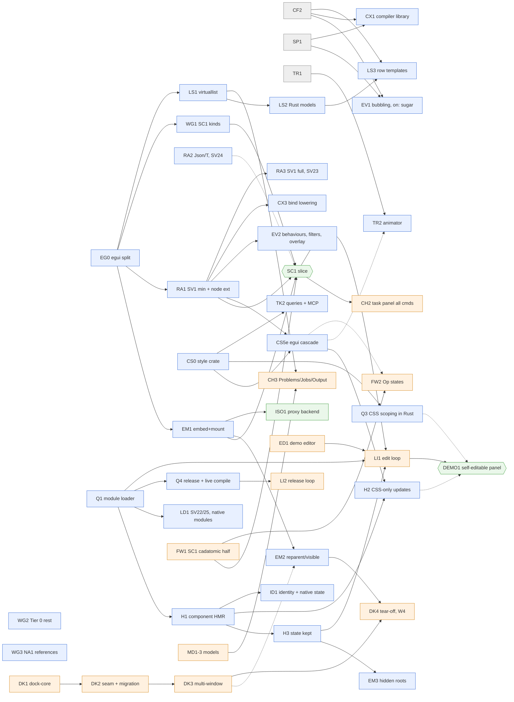

# TRACKS: parallel development tracks for svelters and cadatomic

Status: plan proposal, 2026-10-22. Nothing here is implemented. It turns `plans/research/CADATOMIC.md` and
cadatomic's research into long-lived tracks. The next phase runs two Claude sessions, one per repository. Each
session runs worktree lane agents, and each track is owned by one lane agent at a time.

Read at:

- **svelters**:
  - this branch (`research/cadatomic`, `da426313`) and its base `7aee41e5` (origin/master);
  - local `master` `07620d2b`, which merges CF1 and is not pushed;
  - `plans/research/{CADATOMIC,EGUI,QUICKJS-RUNTIME}.md`;
  - `origin/research/css:plans/research/CSS.md` and `origin/research/hmr:plans/research/HMR.md`;
  - `STATUS.md`, `MATRIX.md`;
  - in-flight lanes: `origin/ci/cf2` (`d2332581`), `origin/ci/tr1` (`3da0b695`, ABI v2.8), `origin/ci/fu3`
    (`a1a13f0b`), `origin/ci/wp-winui`, and SP1 (local worktree only, `1806dd94`; no `origin/ci/sp1` yet).
- **cadatomic `9e73bf6`** (read-only):
  - `CLAUDE.md`, `STATUS.md`, `docs/plan/00-decisions.md`, `01-overview.md` §5–§7, `04-kernel-requests.md`;
  - all `docs/research/2026-10-22-*.md`, and the purpose of each earlier research file.

Sizes are lane-days in the style of `plans/milestones/` and HMR.md §4: one agent lane with the repo's gates.
svelters sizes come from CADATOMIC.md §2–§3 and the research phase tables. cadatomic sizes are the svelters lane's
guesses, because cadatomic's research gives none. The cadatomic lane re-sizes and renames its own milestones.

## 0. Summary

- **20 tracks:**
  - 12 owned by the svelters session. One of them, ISOLATES, has a cadatomic half.
  - 8 owned by the cadatomic session.
  - Two baseline streams compete for the same machine: BASE (svelters' own backends and conformance) and KERNEL
    (cadatomic's M1 and pin work).
- **Tracks are cut along file ownership, not features.** Two lanes in the same files cost more in merges than they
  gain. The worst hot spots are:
  - in svelters: `svelters-egui` (about 2.5k lines today, five files), the compiler's `lower/mod.rs`, and
    `native-runtime/src/index.js`;
  - in cadatomic: `dock/seam.rs`, `app.rs`, `shell/*`, the command registry and `document.rs`.

  One cheap refactor removes most of svelters' egui contention. EG0 splits `svelters-egui` into per-concern
  modules before the egui lanes branch.
- **SC1 is four lanes wide.** EMBED, RUSTAPI and WIDGETS run in svelters, and FRAMEWORK in cadatomic. Each starts
  against stubs. SC1 lands about 9–12 lane-days after wave 1 starts.
- **The critical path to the self-editable panel is the hot-reload chain, not SC1:**

  Q1 module loader → H1 component HMR on the Rust loader → H3 `$state` kept → LI1 edit-loop wiring in cadatomic.

  That is about 18–25 lane-days, against about 9–12 for SC1, so LOADER starts in wave 1. cadatomic's minimal editor
  (ED1) runs beside it. The editor is a Rust pane and needs nothing from svelters. Style edits in the demo add a
  second, almost equally long chain: CS0 → Q3 → CS5 → H2.
- **Machine budget.** At most 4 svelters lanes and 2 cadatomic lanes in wave 1. Builds go through one machine-wide
  slot pool shared by both repositories (§4.1). cadatomic's "one builder" rule becomes "one build at a time per
  slot, several worktree lanes". That change is the user's call (§6 Q1).
- **Coordination.** It extends CADATOMIC.md §5:
  - an SV mirror table in svelters `STATUS.md`;
  - a svelters pin in cadatomic, held in a cadatomic-owned clone so that svelters merges cannot break cadatomic
    builds;
  - integration pins to svelters lane branches, allowed on cadatomic lane branches only;
  - an ABI minor-number allocation line.

## 1. Settled inputs (user, 2026-10-22)

These are taken as given. Where cadatomic's register still says otherwise, the cadatomic session updates its own
files (§5.6). svelters does not edit cadatomic.

| # | Decision | What it changes in the tracks |
|---|---|---|
| 1 | No rquickjs fork; stock QuickJS-NG; no determinism work | cadatomic decision 9, PB5 and the `rquickjs` fork set in `01-overview.md` §6 change. No svelters track does determinism |
| 2 | A bare `on:click` on a component compiles to forwarding an `onclick` callback prop; no legacy component events | EVENTS EV1 implements CADATOMIC.md §6 D1 option (b). cadatomic's SV9 wording and scene-node §2/§10 step 6 are amended |
| 3 | One retained scene, in svelters-egui, extended by kind, behaviour and state providers | The framework research's `KindAdapter` and "svelters arena behind the `Component` trait" (framework §2, §2.2, §12 step 5) are reversed. Per-node cadatomic data (`op`, `pick`, `presents`, `owner`, `anchor`) needs provider storage on the svelters node. No SV request covers it today, so RUSTAPI RA1 adds it |
| 4 | Rust CSS engine back on, all of CSS.md D1–D10, egui first: CS0 → CS5 + CS2 → other backends | No ST3 (decl dialect on egui). SV4, SV5 and SV11 are answered by CS5. egui panels use `Visuals` until then |
| 5 | Own Rust module loader: JS modules and native libraries; live `.svelte` compile in production too; the hot-reload path keeping `$state` by D4 identity; no Vite or Node at run time | HMR.md D1 resolves to (b), the Rust loader. Q1/Q5 come before H1. Q3 (CSS scoping in Rust) and Q4 (release, with the compiler linked in) are required. cadatomic's §7.2 "Off (release)" row (native-extensions research) and the precompiled-only release (js-api §6.3, J6) change |
| 6 | egui 0.37, upgraded jointly; Svelte UI sources in cadatomic; SC1 first; svelters records native-behaviour reference files | A joint upgrade lane per egui minor (§5.2). The `ui/` tree lives in cadatomic. WIDGETS WG3 owns NA1 capture |
| 7 | ST2's JS decl engine stays the interim engine (AppKit); the Rust engine replaces it over time | STYLE retires ST2 last, after CS1/CS4 cover AppKit |

## 2. The tracks

Each entry gives:

- **Owner**: the session, and the lane that owns the track at any one time;
- **Goal**;
- **Sources**;
- **Milestones**: the first 2–4, with sizes;
- **Answers**: SV/SVP ids;
- **Depends**: *hard* means blocked until X lands; *soft* means it works against a stub;
- **Files**: the shared files and the tracks it conflicts with;
- **Stub to start now**.

The full SV→track map is §2.4.

### 2.1 svelters session

#### EMBED: embedding, roots and the Rust node API

- **Owner:** svelters.
- **Goal:** svelters-egui as a library inside someone else's egui frame. It mounts many roots into slots that
  Rust creates, with no toplevel `window`. Roots can be reparented across viewports, hidden and restored, and
  settled for wait-idle.
- **Sources:**
  - CADATOMIC.md §2.5 and §2.8 SVP1–SVP4;
  - docking research §6 and §9 (Root/HostSlot, W2, W4);
  - EGUI.md D1.
- **Milestones:**

  | Id | Content | Size |
  |---|---|---|
  | **EG0** | Split `svelters-egui` without changing behaviour. `backend.rs` becomes `embed.rs`, `walk.rs` and `frame.rs`. `kinds.rs` becomes `kinds/{mod,basic,containers}.rs` with one registration table. New empty `provider.rs`, `events.rs` and `style.rs` hold the extension seams. Merged to master before WIDGETS, RUSTAPI or EVENTS branch | 0.5–1 |
  | **EM1** | The SC1 core. SVP1 splits `logic(&ctx)` from `show_slot(ui, slot)`. SVP2 adds Rust-created slot nodes and a walk per root. SVP3 adds an owned embed handle and salts ids per host and root. SV17 adds `mount`, `set_root_props` and `unmount` from Rust, with one runtime and several roots. SV16 minimum: an `anchor` prop becomes the salted `egui::Id` and the AccessKit author id. SVP4 adds a `settled()` predicate. Test: a kittest of two roots in a host `Ui` | 5–7 |
  | **EM2** | SV18: reparent a root's top node between slots and viewports with no remount, plus a `layout` event. It needs a deferred-viewport walk that reaches the non-`Send` scene through a thread-local. SV19: per-root visibility, with frames paused while hidden | 5–7 |
  | **EM3** | Adaptive hidden roots (docking D5): snapshot and unmount under pressure, restore when shown. SV35 in full: `flush_until_settled(max)` with a reported chain | 4–5 |

- **Answers:** SVP1–SVP4, SV16 (minimum), SV17, SV18, SV19, SV35.
- **Depends:**
  - EM1: none (G0/G1 are done).
  - EM2: soft on cadatomic DK3 (W2 thread-local viewports). EM2 carries its own two-viewport harness.
  - EM3: hard on HMR H3, which provides the snapshot and restore machinery.
- **Files:**
  - `svelters-egui/src/{embed,walk,frame,scene}.rs` and `svelters-host/src/lib.rs` (the `Host` embed API).
  - Conflicts with WIDGETS on `scene.rs` and with EVENTS on `walk.rs`. EG0 cuts both down to the registration
    table.
- **Stub to start now:** nothing is needed. EM1 can start the day EG0 merges.

#### RUSTAPI: Rust ↔ Svelte surface (providers and exports)

- **Owner:** svelters.
- **Goal:** one macro family and one schema for:
  - Rust widgets as Svelte elements (`#[svelters::widget]`, SV1);
  - Rust data crossing as typed values (E0 + SVP5);
  - run-time API descriptors (SV23/SV24);
  - provider-owned per-node storage (the C2 gap).
- **Sources:**
  - CADATOMIC.md §2.1, §2.4, SVP5;
  - EGUI.md §3.3 and §6 ("one macro family");
  - `docs/notes/egui-rust-exports.md` §7;
  - js-api research §3, §8.
- **Milestones:**

  | Id | Content | Size |
  |---|---|---|
  | **RA1** | SV1 minimum, the struct form. A provider crate registers a kind with typed props, events and a Rust `Widget` (`measure`, `ui`, a11y name). The backend merges it into the kind table. The compiler takes the spec fragment (`--spec`, build API). `.d.ts` output. Plus the **provider extension block on the node**: typed per-provider data and named provider state bits set from Rust (the storage half of SV4). Plus SV10's rule for provider kinds (writes go through `cx.set`, so the class is `exact`) | 4–5 |
  | **RA2** | SVP5: `Json<T: Serialize + DeserializeOwned>` with `JsonSchema` typings, and data enums (`#[js(tag)]`). SV24: codegen over a `&Schema` value | 4–5 |
  | **RA3** | SV1 in full: the fn form, `wrap_widget!`, methods, slots, a capability bitset, and behaviour trait objects (the registration side of SV2). SV23: dynamic export modules from a descriptor with publisher generations | 8–10 |

- **Answers:** SV1, SV10, SV23, SV24, SVP5. Also the storage half of SV4.
- **Depends:**
  - RA1: hard on EG0.
  - RA2: none.
  - RA3: soft on LOADER LD1, the resolver that serves dynamic modules.
- **Files:**
  - `svelters-macros`, `crates/svelters`, `svelters-host/src/exports/*`, `svelters-egui/src/provider.rs`,
    `metadata/semantics/egui.json` (generated).
  - Conflicts with LOADER on the `svelters:app/*` resolution in `quickjs.rs`, and with COMPILER on spec loading.
- **Stub to start now:** RA2 needs nothing. Until RA2 lands, cadatomic's SC1 exports can pass JSON strings
  (`String` in, `JSON.parse` in JS), which sidesteps the orphan rule.

#### WIDGETS: the egui element library and native-behaviour references

- **Owner:** svelters.
- **Goal:** the built-in egui kinds cadatomic's panels need, each with accessible names, gallery pages, ledger
  facts and kittest snapshots. Plus native-behaviour reference files (decision 6).
- **Sources:**
  - EGUI.md §5 (Tier 0/1/2), §7 G2/G4;
  - widget survey §2.2 (P0/P1, R/S), §4.1, §5 (NA0–NA5);
  - CADATOMIC.md SC1 row and G2c.
- **Milestones:**

  | Id | Content | Size |
  |---|---|---|
  | **WG1** | SC1 subset: `grid` (taffy `grid` feature), `collapsing-header`, `toggle-button` (segmented), `combo-box`, `separator`, `scroll-area`, `icon` (SVP6, with `font-weight` mapped to registered families), `tooltip` on every kind, an `invalid` flag. Accessible names forwarded, since egui_kittest 0.37 fails unnamed inputs | 4–5 |
  | **WG2** | G2c, the rest of Tier 0 for panels: X4 menus and context menus, popover, modal and dialog roots, progress bar, spinner, hyperlink, image | 6–8 |
  | **WG3** | NA1 native capture. svelters records reference files as `conformance/golden/<platform>/<toolkit>-<version>.json` for widget-survey pins 1–3 and 7, on GTK and Qt under `tools/dev/headless`. It also closes the svelters gaps the survey lists in §4.1: caret, selection and focus observation; a GTK XTEST injector; and a `state #h {…}` trace writer for `oplog-compare.mjs` | 6–8 |
  | **WG4** | G4 Tier 1: `table` (egui_table 0.11), `tab-view`, `split-view`, `toast`, `rfd` dialogs returning Promises, date and colour pickers, drag and drop. `tree-view` waits for LISTS LS2 | 10–14 |

- **Answers:** SVP6 and part of the SV11 element set. It also produces the reference files of decision 6, which
  CADATOMIC.md §6 D8 and widget survey W3 ask for.
- **Depends:**
  - WG1: hard on EG0.
  - WG2: soft on EVENTS EV3. Menus need focus restore; without it they degrade to egui's own focus handling.
  - WG3: none, since it uses the native backends.
- **Files:**
  - `svelters-egui/src/kinds/*`, `layout.rs` (per-kind measure), `render.rs`, `metadata/egui`, the gallery.
  - Conflicts with STYLE CS5 (per-kind paint reads computed style) and LISTS (`virtuallist` kind registration).
  - WG3 touches `tools/metadata/*`, the op-log format (`backend-abi.md`) and `.github/workflows/*`.
- **Stub to start now:** WG3 can start today. It touches no egui file.

#### STYLE: the Rust CSS engine

- **Owner:** svelters.
- **Goal:** CSS.md option (c) with D1–D10 as recommended, egui first. One Rust engine is the selector and cascade
  authority. Hover runs no JS. ST2's JS decl engine is retired last.
- **Sources:**
  - CSS.md §2, §5 (CS0–CS6), §8;
  - scene-node research §6 (cadatomic's CSS subset, now this engine's scope);
  - CADATOMIC.md SV4/SV5/SV11.
- **Milestones:**

  | Id | Content | Size |
  |---|---|---|
  | **CS0** | `crates/svelters-style`: `cssparser` 0.38 + `selectors` 0.41 (D5), matching through an `Element` trait, cascade, `var()`, `calc()`, media, invalidation maps, `ComputedStyle`. The Rust style tables come from `gen_props.py`. Standard CSS names where a mapping is faithful (D1). No toolkit linked | 5 |
  | **CS5e** | The egui cascade. The svelters-egui scene implements `Element` directly, which is CS1's egui half; the host mirror for the other backends waits. Computed style feeds taffy `Style` and paint. Node state flags (hover, active, focus, focus-within, disabled, checked, selected, open, expanded, invalid, exiting) come from the same frame's response. Provider states from RA1 match as pseudo-classes (SV4). SV5 adds `Host::set_tokens(scheme, map)` with the provider's namespace (`--cad-*`). `class:` and `style:` work on egui. Insets, `%`, taffy `grid` and `calc` | 6–8 |
  | **CS1** | The host `StyleTree` for GTK, Qt, AppKit and WinUI. Setter rules everywhere. Compile-time matching retired (D9) | 5 |
  | **CS3 / CS4 / CS6** | Rule classes on GTK/Qt; AppKit/WinUI states and visuals, which retire ST2; motion and taffy layout containers (D4, D7) | per CSS.md §5 (about 4.5 lanes) |

- **Answers:** SV4 (matching), SV5, SV11.
- **Depends:**
  - CS0: none.
  - CS5e: hard on CS0 and RA1 (provider state bits).
  - CS1: hard on CS0.
- **Files:**
  - `crates/svelters-style` (new), `svelters-egui/src/style.rs`, `packages/style`, `tools/metadata/style`,
    `lower/mod.rs` (only when CS1 retires the compile-time matcher).
  - Conflicts with WIDGETS on per-kind paint. Sequence CS5e after WG1, or agree that `render.rs` reads a
    `ComputedStyle` with defaults from `Visuals`.
- **Stub to start now:** CS0 is a new crate with no conflicts.

#### LOADER: the Rust module loader and live compile

- **Owner:** svelters.
- **Goal:** decision 5. The loader resolves, compiles and loads `.svelte`, `.svelte.js`, `.ts`, JSON and assets
  into QuickJS from source or from bytecode, with no Vite or Node. It does so in release builds too, so a running
  app compiles edited sources. It also serves native module providers and per-host resolver hooks.
- **Sources:**
  - QUICKJS-RUNTIME.md §3 and §6 (Q1–Q8);
  - HMR.md §3.2 (delivery);
  - js-api research §4.2 (`cadatomic:api/*`, synchronous loader), §6.4 (edit loop).
- **Milestones:**

  | Id | Content | Size |
  |---|---|---|
  | **Q1** | `crates/svelters-modules`: `ModuleProvider`, `oxc_resolver` plus data-driven aliases, transforms for `.svelte`/`.svelte.js`/`.js`/`.json`/assets, in-memory source maps, a graph-driven watcher with today's full reload. Runner `--entry`; `--bundle` keeps working. Also a **source overlay**: in-memory file contents by path, read before disk, so an editor's unsaved buffer can be compiled for diagnostics | 4–5 |
  | **LD1** | SV22: per-host resolver and loader hooks for extra schemes. SV25: per-host visibility filter for `svelters:app/*`. **Native module providers** through the same `ModuleProvider`: the statically registered E0 `inventory` modules first; dlopen'd libraries behind a cargo feature (§6 Q3) | 3–4 |
  | **Q2 + Q3** | TS entry points and the on-disk bytecode cache. Q3: Svelte CSS analyze/prune/scope ported to Rust on the `svelters-style` parser, so `<style>` builds with no Node, byte-identical to svelte@5.57.2 on the fixture corpus | 2–3 + 5 |
  | **Q4** | Release: `app.qbc` (bytecode table, version stamp, `strip_source`) **plus the compiler and loader linked into release builds**, so the same live-compile path runs in production (decision 5). Size and startup are measured with and without the compiler | 3–4 |

- **Answers:** SV22, SV25, and decision 5's loader. SV27 stays in COMPILER, although the loader is its first
  consumer.
- **Depends:**
  - Q1: none. QUICKJS-RUNTIME's "N1 rename settled" precondition is met (N1 is DONE).
  - Q3: hard on STYLE CS0.
  - LD1: none.
- **Files:**
  - `crates/svelters-modules` (new), `svelters-host/src/{quickjs.rs,reload.rs,engine.rs}`
    (`JsEngine::load_module` changes signature), runner binaries, `packages/native-runtime/package.json` (the
    alias table).
  - Conflicts with RUSTAPI on the resolver for `svelters:app/*`, and with HMR on `reload.rs`. One lane per file
    family, in order: LOADER Q1, then HMR H1.
- **Stub to start now:** nothing is needed. Apps with `<style>` stay on the Vite path until Q3.

#### HMR: hot reload with state and identity

- **Owner:** svelters.
- **Goal:** an edit swaps one component in place in one long-lived runtime, keeps `$state` (D9, SV20/SV36), and
  restores native UI state (focus, caret, scroll) by a compiler-emitted identity. It is delivered by LOADER, not
  Vite.
- **Sources:**
  - HMR.md §3–§4 (H0–H5) and §6;
  - docking research §7.1–§7.2 (the state rule), W7;
  - Slint lessons §7.4 (SV30, SV36);
  - EGUI.md D4.
- **Milestones:**

  | Id | Content | Size |
  |---|---|---|
  | **H0** | Full-reload hardening: geometry carry-over, egui reload test, failed-reload source maps | 2–3 |
  | **H1** | Component HMR on the Rust loader (H1 + Q5 merged): compiler `--hmr` wrapper, runtime `hmr()` with rollback, `import.meta.hot` per module, versioned re-import, full-reload fallback, a swap budget for QuickJS memory. Plus a swap of one root in a kittest with several roots, leaving the other roots' handles untouched | 7–9 |
  | **H3** | `$state` kept: keyed declarations, signature, per-instance registry, `// @hmr:reset`, `.svelte.js` module state; SV36 (keep only changed values). The state rule is §6 Q4 | 4–6 |
  | **ID1** | SV16 in full: compiler identity (file + template position + key path + instance path), salted by root. H4: native UI state captured and restored by identity, with egui using it as `egui::Id`. Then H2 (CSS-only updates, once CS5e exists) and SV30 (dev live value overrides) | 8–12 |

- **Answers:** SV16 (full), SV20, SV30, SV36. It also provides the snapshot machinery for docking D5 (EMBED EM3).
- **Depends:**
  - H1: hard on LOADER Q1.
  - H3: hard on H1.
  - H2: hard on STYLE CS5e.
  - ID1: soft on CF2 being merged; CF2's template structure feeds the template-position part of the identity.
- **Files:**
  - `svelters-compiler/src/{target.rs, hmr/*}` (new), `packages/native-runtime/src/{index.js, hmr.js}`,
    `svelters-host/src/reload.rs`.
  - Conflicts with MOTION, CF2 and SP1 on `native-runtime`, and with COMPILER on codegen.
- **Stub to start now:** H0 needs nothing.

#### EVENTS: propagation, behaviours, focus and overlays

- **Owner:** svelters.
- **Goal:** capture and bubbling on the egui scene, decision 2's forwarding sugar, native Rust behaviours behind
  `use:`, Rust event filters and overlay hooks (the svelters half of typed picking and tutorials), and focus.
- **Sources:**
  - CADATOMIC.md §2.1–§2.2 (SV2, SV6, SV7, SV9, SV12);
  - scene-node research §2 and §4;
  - widget survey pin 7.
- **Milestones:**

  | Id | Content | Size |
  |---|---|---|
  | **EV1** | SV9: capture and bubbling on egui, matching ABI v2.2 phases. A bare `on:click` inside a component lowers to `onclick={$$props.onclick}` and is typed as a callback prop (decision 2). SV12: an egui test of `use:` → attachment | 5–6 |
  | **EV2** | SV2: native behaviours, spelled `import { pick } from 'svelters:behaviors'` (CADATOMIC.md amendment). SV6: Rust filters per subtree in the propagation walk. SV7: an `Overlay` trait after the walk, with rects by node, anchor or identity | 6–8 |
  | **EV3** | Focus: `focus-scope`, restore on root activation, traversal order, key and pointer sync handlers before the pass | 4–5 |

- **Answers:** SV2, SV6, SV7, SV9, SV12.
- **Depends:**
  - EV1: hard on CF2 and SP1 being merged (`lower/mod.rs`); soft on EG0.
  - EV2: hard on RA1 (registry), soft on EM1 (anchors).
- **Files:**
  - `svelters-egui/src/{events,walk}.rs`, `svelters-compiler/src/lower/mod.rs`.
  - Conflicts with EMBED on `walk.rs`, and with COMPILER, HMR, CF2 and SP1 on `lower/mod.rs`.
- **Stub to start now:** EV1's egui propagation half can start after EG0. The lowering half waits for CF2 and SP1.

#### LISTS: the list protocol on egui and Rust models

- **Owner:** svelters, paired with cadatomic MODELS.
- **Goal:** big lists, tables and trees whose data stays in Rust. T1 is the JS array (M5). T2 is a Rust model with
  row records. T3 is script-free row templates.
- **Sources:**
  - models research §6.3, §7 (SV40–SV47), §9 (MX5);
  - M5 and N3 milestones;
  - EGUI.md §4 (static-template op).
- **Milestones:**

  | Id | Content | Size |
  |---|---|---|
  | **LS1** | SV40: `virtuallist` on egui, with recycled row slots, variable heights, scroll anchoring by key, set-size a11y. SV47: T1 benches | 6–8 |
  | **LS2** | SV41: a Rust row-model trait in `svelters-host`, engine-neutral and adaptable on GTK/Qt. SV46: key-based multi-selection with deltas. SV44: columns and tree rows (closes M5 item 3 and N3 item 5). T2 benches | 10–14 |
  | **LS3** | SV42: row records. SV43: row templates as the cross-backend static-template op. MX5: zero JS calls per page | 12–16 |

- **Answers:** SV40–SV44, SV46, SV47. SV45 is answered in COMPILER.
- **Depends:**
  - LS1: hard on EG0, soft on WG1.
  - LS2: hard on LS1.
  - LS3: hard on CF2 being merged.
- **Files:**
  - `svelters-egui/src/kinds/virtuallist.rs`, `svelters-host` (model trait), `svelters-abi` and the M5/N3
    sections of `backend-abi.md` (new ABI minors), `packages/lists`.
  - Conflicts with WIDGETS on kind registration (EG0 makes this one line).
- **Stub to start now:** cadatomic MODELS MD1–MD6 need nothing from svelters (models research §11).

#### MOTION: animation

- **Owner:** svelters.
- **Goal:** transitions and animations that run in the scene from descriptors, with no JS per frame on egui.
- **Sources:**
  - TR1 milestone (in flight; §3, §5);
  - CADATOMIC.md §2.3;
  - scene-node research §5.
- **Milestones:**

  | Id | Content | Size |
  |---|---|---|
  | **TR1** | In flight; finish and merge. It claims ABI v2.8 | (remaining) |
  | **TR2** | SV13: the native animator. Keyframes and timing are sent once (`SVL_STYLE_ANIMATE`), the egui scene interpolates and reports `outro_done`, exiting nodes are non-pickable, FLIP uses `bounds` on egui, reduced motion, a virtual clock in kittest. SV37: demand per root and viewport, and a slow-motion factor | 10–14 |
  | **TR3** | SV14 in-process half: profile per-frame `tick` against descriptors (frame time, power). The isolate half moves to ISOLATES | 2–3 |

- **Answers:** SV13, SV14 (in-process), SV37.
- **Depends:**
  - TR2: hard on TR1 being merged; soft on STYLE CS5e for implicit `transition:` declarations; soft on EM2 for
    per-root demand.
- **Files:**
  - `svelters-egui/src/anim.rs` (new), `packages/native-runtime/src/core/*` (TR1's player), `svelters-abi`.
  - Conflicts with HMR on the runtime.
- **Stub to start now:** TR1 is already running.

#### COMPILER: compiler extension points and language services

- **Owner:** svelters.
- **Goal:** the compiler as a library for an in-app editor, and provider-declared compile-time knowledge. Each
  provider supplies data (bind sources, checks, types), so svelters stays one compiler with no cadatomic code.
- **Sources:**
  - CADATOMIC.md §2.1 (SV3, SV8), §2.6 (SV27, SV31–SV33);
  - code-editor research §5 and §10;
  - js-api research §8.
- **Milestones:**

  | Id | Content | Size |
  |---|---|---|
  | **CX1** | SV27: compile one file in-process for diagnostics only (no codegen); incremental state per file; fix-its; namespaced and documented stable codes | 3–5 |
  | **CX2** | SV8: provider checks declared in the spec, plus a `Check` trait; codes like `cad.slot_unknown`. SV31: kind contracts and typed slots | 6–8 |
  | **CX3** | SV3: a bind-target lowering table (a native `link(store, field, node, prop)` with no JS per keystroke; draft bindings; `\|commit`) | 5–7 |
  | **CX4** | E5 + SV26 (type facts from an `exports.json` supplied at run time) + SV45 (`Model<Row>`, `Quantity<dim>`, `Ref<type>` typings). Then SV32 (loop, purity and unit checks) and SV33 (a language server over CX1) | 5–7, then 16–25 |

- **Answers:** SV3, SV8, SV26, SV27, SV31, SV32, SV33, SV45.
- **Depends:**
  - CX1: hard on CF2 and SP1 being merged; it can start on `diag.rs` before that.
  - CX2: hard on RA1.
  - CX3: hard on RA1.
  - CX4: hard on RA2.
- **Files:**
  - `svelters-compiler/src/{lower/mod.rs, diag.rs, compile.rs, semantics/*}`.
  - Conflicts with EVENTS, HMR, CF2, SP1 and TR1 on the compiler. **Only one compiler-writing lane runs at a
    time** (§4.3).
- **Stub to start now:** CX1's diagnostics-only entry point touches only `compile.rs` and `diag.rs`.

#### ISOLATES: third-party roots off the UI thread (joint)

- **Owner:** joint. The svelters half is the proxy backend, the isolate host and the compiler target. The
  cadatomic half is the bus transport (remoc or irpc, C4), supervision and the U5 policy.
- **Goal:** isolates send op batches to the UI thread. A crash or loop interrupts only that isolate's roots.
- **Sources:**
  - CADATOMIC.md §2.4 (SV15, SV21);
  - framework research §5.1–§5.2;
  - docking research §6.2–§6.4 (W5, W6).
- **Milestones:**

  | Id | Content | Size |
  |---|---|---|
  | **ISO1** | A proxy (channel) backend over a transport trait (no tokio in svelters), a message-driven isolate host, handles minted in the isolate, and a `get_prop` mirror fed by `changed` batches | 8–10 |
  | **ISO2** | The compiler isolate target (calls are Promises, sync handlers are errors). SV21: root ids, sequence numbers, detached build, queue bounds, coalescing | 6–8 |
  | **ISO3** | W5/W6 on the svelters side and the SV14 isolate half. In cadatomic: remoc transport, supervisor, policy grants | 3–4 + cadatomic |

- **Answers:** SV14 (isolate half), SV15, SV21.
- **Depends:**
  - ISO1: hard on EM1 (mount into slots).
  - ISO2: hard on EV1 (sync-handler semantics) and COMPILER CX1.
- **Files:** `crates/svelters-proxy` (new), the compiler target. These conflict little.
- **Stub to start now:** nothing until EM1. This track is wave 4.

#### TESTKIT: tests, queries, MCP and accessibility audits

- **Owner:** svelters. Joint acceptance tests run in cadatomic.
- **Goal:** one test case against every backend, selector and role queries in Rust (CS2), `svelters mcp`, and
  accessibility audits.
- **Sources:**
  - CSS.md §2.9 and CS2;
  - Slint lessons §8 (SL5, SL6);
  - CADATOMIC.md SV34 and SV35;
  - EGUI.md D5.
- **Milestones:**

  | Id | Content | Size |
  |---|---|---|
  | **TK1** | SV34: a single `.svelte` case with inline expectations, dispatched to GTK, Qt, egui and the log backend (later the isolate target). It reuses the op-log replay and the conformance ratchet. kittest snapshots through the `wgpu` feature on lavapipe | 3–5 |
  | **TK2** | CS2: `host.query`, a `Locator` in `svelters-host::testing` (selectors + `:text`, `:role`, `:name`), a kind→role table generated from metadata, `computed(h)`, `svelters mcp` over a debug socket, egui merged into `egui_mcp::UiServer`. SL5: kittest, scenarios and MCP resolve the same selector to the same node | 5–7 |
  | **TK3** | An a11y audit: AccessKit tree checks in kittest (every input named, set-size on lists, author ids from anchors, no id clashes across roots); NA3 role and state tables on Linux | 3–4 |

- **Answers:** SV34, and the svelters halves of SL5/SL6 and C5.
- **Depends:**
  - TK1: none.
  - TK2: hard on CS0 for selectors (role and name queries can come first).
- **Files:**
  - `svelters-host/src/testing.rs`, `svelters-cli` (`mcp`), `tools/oplog-compare.mjs`, `experiments/native-compiler/conformance`.
  - TK1 conflicts with CF2 and SP1 on the conformance runner.
- **Stub to start now:** TK1 can start immediately.

**Accessibility is not a separate track.** It is spread across tracks:

- every kind's a11y projection is a WIDGETS acceptance item;
- ids come from EMBED (anchors) and HMR (identity);
- audits are TESTKIT TK3;
- screen-reader tests across windows (W9) belong to cadatomic DOCK;
- editor paging and IME (E7, E9) belong to EDITOR.

A dedicated lane would mostly re-open other tracks' files.

### 2.2 cadatomic session

These are proposals; the cadatomic lane decides. Sizes are svelters' guesses. Ids such as `W1` and `MX1` refer to
cadatomic's experiments. The docking W-ids and the versioning requirement W-ids collide, so this file writes
"dock-W" and "ws-W".

#### FRAMEWORK: the cadatomic component framework crate

- **Owner:** cadatomic.
- **Goal:** cadatomic's own crate on svelters extension points. It holds:
  - tokens and themes;
  - `Op<T>` waiting states bound to sessions and jobs;
  - the type registry and typed picking;
  - cadatomic components as SV1 kinds;
  - the cadatomic half of SC1.
- **Sources:**
  - framework research §2–§4 and §12 steps 1–4, 8;
  - scene-node research §1 and §9.1;
  - CADATOMIC.md §3.1 (cadatomic half).
- **Milestones:**

  | Id | Content | Size |
  |---|---|---|
  | **FW0** | Framework step 1: three token layers, scales, four themes, a lint for hard-coded colours. svelters-independent | 3–4 |
  | **FW1** | The SC1 cadatomic half: a `SvelteView: ViewClass` hosting one slot behind a setting; the exports module `svelters:app/task` (an E3 store plus `setField`/`accept`/`cancel`/`rebase`, `units.parse`, `catalog.t`); a `QuantityField` kind through SV1; `ui/` sources built by `check.sh`; `settled()` registered with `IdleBarrier`; SVP7 (`default-features = false`) and SVP8 (QuickJS opt-level); the kittest port of `task_forms.rs` | 5–7 |
  | **FW2** | Framework step 2: `Op<T>` bindings (`Button::command`, `QuantityField::slot`, `JobChip`, `PendingMark`, `StaleBanner`). It is styled through provider states once STYLE CS5e lands; before that it uses kind props | 5–7 |
  | **FW3 / FW4** | Step 3: type registry and typed picking (SV2, SV6, SV7). Step 4: `ListItem`, `PropertyGrid`, `EmptyState` as kinds, plus the gallery app | 6–8 each |

- **Answers:** SVP7, SVP8. It is the consumer of SV1–SV8.
- **Depends:**
  - FW1: hard on EM1, RA1 and WG1 for acceptance; it builds against stubs before then.
  - FW3: hard on EV2.
- **Files:** `cadatomic-app/src/theme/mod.rs`, `forms/`, `task_panel/`, `views/`, the new crate, workspace
  `Cargo.toml`, `pins.toml`.
- **Stub to start now:**
  - FW0 needs nothing.
  - FW1 can write `ui/` and the exports module against `@svelters/native-runtime` today.
  - Until EM1, FW1 can host the panel through svelters' existing eframe runner in a test.

#### DOCK: docking and windows

- **Owner:** cadatomic.
- **Goal:** cadatomic's own docking (U2). A headless dock-core, the seam over it, multiple OS windows as full
  shells (D1, D2), floating panels (D3), layouts per user and project with profiles (D6), layout undo (D8),
  cross-window drag and tear-off (D7, with a winit fork), and roots that move without remounting (dock-W4).
- **Sources:** docking research §5, §5.11, §8, §11.8–§11.10 (dock-W1–W19, D12–D17); ide-shell research §2 and §5.
- **Milestones:**

  | Id | Content | Size |
  |---|---|---|
  | **DK1** | Headless `dock-core`: model, commands, invariants, integer solver, drop resolver, layout file v2 with schema (dock-W1, W14, W15). No egui | 5–7 |
  | **DK2** | `dock/seam.rs` over DK1, drawn in plain egui; layout v1→v2 migration; egui_tiles deleted | 5–7 |
  | **DK3** | Multiple windows: deferred viewports through a thread-local scene (dock-W2), full-shell secondary windows (D1, D2), floating panels (D3), profiles (D6), layout undo (D8) | 8–12 |
  | **DK4** | Cross-window drag and tear-off (dock-W3, W12, W16, W17; winit fork per D7); roots moved without remount (dock-W4, with EM2); screen readers across windows (dock-W9) | 8–12 |

- **Answers:** none. It consumes SV17–SV19.
- **Depends:**
  - DK1 and DK2: none.
  - DK3: soft on EMBED EM2.
  - DK4: hard on EM2.
- **Files:**
  - `dock/*`, `app.rs` (frame loop), `shell/layout.rs`, `cadatomic-core/src/{view,settings,keymap}.rs`, root
    `Cargo.toml`, `forks.toml`.
  - Conflicts with CHROME on `shell/*` and `app.rs`, and with WORKSPACE (`PaneId`→document).
- **Stub to start now:** DK1 is headless.

#### CHROME: shell chrome and panel contents

- **Owner:** cadatomic.
- **Goal:** the shell of ide-shell §2. Rust owns the command strip, menus, toolbars, stripes and tabs. Panel
  contents move to Svelte roots one at a time: properties/task, Problems/Jobs/Output/Review, the model tree and
  status sections. Palette and search follow U4.
- **Sources:**
  - ide-shell research §2–§6, §8 (build order);
  - widget survey P0 rows;
  - SCOPE §5.1.
- **Milestones:**

  | Id | Content | Size |
  |---|---|---|
  | **CH1** | Fixed regions and stripes, the editor header grammar, disable-with-reason on the command strip (Rust; ide-shell §8 items 1–2) | 4–6 |
  | **CH2** | The properties/task panel in Svelte for every command (generalising SC1's `body.box`), with draft bindings once CX3 lands | 5–7 |
  | **CH3** | Problems, Jobs and Output as Svelte roots on LISTS LS1/LS2 and MODELS. Status bar sections as `HostSlot::Section` roots | 6–8 |
  | **CH4** | Palette and search: U4 metadata lint and filtering through MODELS (`Predicate`), semantic search later. Model tree on `TreeFlatten` | 5–7 |

- **Answers:** none. It is the main consumer of WIDGETS, LISTS and EVENTS.
- **Depends:**
  - CH1: soft on DK2.
  - CH2: hard on SC1; soft on WG2 and CX3.
  - CH3: hard on LS1; soft on LS2.
  - CH4: hard on MD1–MD3.
- **Files:**
  - `shell/*`, `palette/`, `problems/`, `task_panel/`, `tree/`, `action_bar/`, `cadatomic-core/src/palette.rs`.
  - Conflicts with DOCK on `shell/*` and with MODELS on `palette.rs` and `tree/`.
- **Stub to start now:** CH1 is pure Rust, but it should follow DK2 or be serialised with it.

#### EDITOR: code editor and language services

- **Owner:** cadatomic, paired with svelters COMPILER.
- **Goal:** cadatomic's own Rust `CodeEditor`, which is not egui `TextEdit` and not a Svelte component. The
  editing surface must survive a broken Svelte edit (js-api §6.5–§6.6). It is exposed to Svelte panels as a
  `<code-editor>` kind through SV1, and it is the editor of the self-editable demo.
- **Sources:** code-editor research §4, §7–§9 (P0–P3, E1–E12, T1–T12); js-api research §6.4–§6.6.
- **Milestones:**

  | Id | Content | Size |
  |---|---|---|
  | **ED1** | The demo editor, a reduced P0: `TextBuffer` (ropey), `text.edit` commands with undo groups, virtualised lines and a galley cache, one cursor and selection, clipboard, find, highlighting for Svelte/TS/CSS, svelters diagnostics inline (`compile()` today, CX1 later), open and save of files under `ui/`. Shown in a Rust dock pane | 8–12 |
  | **ED2** | The rest of P0: multi-cursor, folding, IME (E7), AccessKit paging (E9), Monaco fixtures ≥ 90 % (E11), widget-survey pins 1–6, the `doc.text` workspace kind (with WORKSPACE WS1). Exposed as an SV1 kind | 12–16 |
  | **ED3** | P1: `cadatomic-lsp`, `cadatomic-ls`, svelters-ls over SV33 | (P1 scale) |

- **Answers:** none. It consumes SV1, SV27 and SV33.
- **Depends:**
  - ED1: none. It is a Rust pane and uses `svelters_compiler::compile` as is.
  - ED2: hard on RA1 (as a kind); soft on WS1.
  - ED3: hard on CX4/SV33.
- **Files:**
  - `cadatomic-core` (text model, commands, `keymap.rs`, `context.rs`), the command registry, `Cargo.toml`
    (ropey, tree-sitter).
  - Conflicts with WORKSPACE and EXTENSIONS on the registry and `document.rs`.
- **Stub to start now:** ED1 needs nothing from svelters.

#### LIVEIDE: the edit loop, source layers and API publishing

- **Owner:** cadatomic, paired with svelters LOADER and HMR.
- **Goal:**
  - wire the editor to the loader and HMR, which is the self-editable panel;
  - add source layers, overlays, safe mode and the release-build edit loop (AP7, AP8);
  - publish `cadatomic:api/*` with typings (AP1, AP5).
- **Sources:** js-api research §3–§7, §9 (AP1–AP10), J6.
- **Milestones:**

  | Id | Content | Size |
  |---|---|---|
  | **LI1** | The dev edit loop and DEMO1 (§3.2). cadatomic's `SvelteView` loads `ui/` through `svelters-modules`. The editor's buffer goes into the loader's source overlay for diagnostics; save triggers H1/H3 | 3–5 |
  | **LI2** | Source layers and overlays with a base hash, safe mode, last-good, staged apply, and the release-build loop (AP7, AP8). It needs Q4 | 6–8 |
  | **LI3** | `ApiRegistry`, `cadatomic:api/*` through SV22 and SV23, typings through SV24 (AP1, AP5). MCP `ide.*` and `api.*` tools (AP9) | 8–10 |

- **Answers:** none. It consumes SV20, SV22–SV27.
- **Depends:**
  - LI1: hard on Q1, H1, H3, ED1 and SC1.
  - LI2: hard on Q4.
  - LI3: hard on LD1 and RA3.
- **Files:** `cadatomic-app` `scripting` and `ide` modules (new), `cadatomic-cli/src/mcp/tools.rs`,
  `cadatomic-core/src/schema/mod.rs`.
- **Stub to start now:** nothing before Q1. LIVEIDE is wave 2.

#### MODELS: models and filtering

- **Owner:** cadatomic, paired with svelters LISTS.
- **Goal:** headless `RowSet`/`Model`, proxies, the `Predicate` engine, `TreeFlatten`, selection and columnar
  chunks. Models research §11 says steps 1–6 need nothing from svelters.
- **Sources:** models research §3–§6, §8, §9 (MX1–MX10), §11.
- **Milestones:**

  | Id | Content | Size |
  |---|---|---|
  | **MD1** | `RowSet`, keys, deltas, `Filter`/`Sort`; the palette ported to a tethered filter job | 4–6 |
  | **MD2** | Query AST and search-bar parser checked against reflected schemas; `cadatomic query` | 4–6 |
  | **MD3** | `TreeFlatten` and the selection model; the A6a tree moved onto them (MX3, MX10) | 4–6 |
  | **MD4** | Binding to LISTS: SV40/SV41 adapters in the framework crate, then T3 (MX5) | 3–5 |

- **Depends:** MD1–MD3: none. MD4: hard on LS1 and LS2.
- **Files:**
  - `cadatomic-core/src/{palette.rs, inspect/selection.rs, units.rs, schema/}`, `cadatomic-app/src/tree/mod.rs`,
    a new `cadatomic-model` crate.
  - Conflicts with CHROME on `palette.rs` and `tree/`.
- **Stub to start now:** all of MD1–MD3.

#### WORKSPACE: workspace and document versioning

- **Owner:** cadatomic.
- **Goal:** many documents and kinds, the `Document`/`DocumentModel` split, then an object store, a remote
  backend and the hub (versioning research §7).
- **Milestones:**

  | Id | Content | Size |
  |---|---|---|
  | **WS1** | A `Workspace` with many `DocumentKey`s, `DocumentModel` per kind, a local backend seam; existing tests stay green | 6–8 |
  | **WS2** | Object store and canonical encoding, once the user answers V1 and V5 | 6–10 |

- **Depends:** WS2 is hard on V1–V5. There is no svelters dependency.
- **Files:**
  - `cadatomic-core/src/{dispatch.rs, document.rs, executor/*, scene_pipeline*, jobs*, log/}`, `view_seam.rs`.
  - Conflicts with EDITOR (`doc.text`), EXTENSIONS and DOCK (pane → document).

#### EXTENSIONS: native workers, manifests and policy

- **Owner:** cadatomic.
- **Goal:** manifest-first lazy activation in the static binary (NX2), outboard workers for batch jobs (NX6), U5
  policy enforcement (NX10), and a remote runner (NX11).
- **Sources:** native-extensions research §7.4, §8 (NX1–NX11, OB1–OB11, SY1–SY6).
- **Milestones:** NX1 + NX2 (5–7), then NX6 + NX10 (8–10).
- **Depends:** OB requests to outboard; nothing from svelters.
- **Files:** `cadatomic-core/src/command/{entry,registry,mod}.rs`, `document.rs`, `executor/mod.rs`, `check.sh`.
  This is the biggest three-way hot spot with EDITOR and LIVEIDE.

### 2.3 Baseline streams (not cadatomic-facing, but competing for slots)

- **BASE (svelters).** In flight:
  - CF2 (template effects);
  - SP1 (spread and `<svelte:element>`);
  - FU3;
  - WP-W (WinUI parity).

  Later: iOS and Android, CS1/CS3/CS4 for the native backends, NT/N follow-ups. CF1 sits on local `master`
  `07620d2b` and is not pushed. Push it before wave 1 so that the lanes branch from it.
- **KERNEL (cadatomic).** The M1 leftovers, cylinder cap normals, kapi2, pin advances (`STATUS.md` "Open").

### 2.4 Request → track map

| Ids | Track (milestone) |
|---|---|
| SV1 | RUSTAPI (RA1 minimum, RA3 full) |
| SV2 | EVENTS (EV2); registration in RUSTAPI RA3 |
| SV3, SV8, SV26, SV27, SV31–SV33, SV45 | COMPILER (CX1–CX4) |
| SV4 | RUSTAPI RA1 (storage, state bits) + STYLE CS5e (matching) |
| SV5, SV11 | STYLE (CS5e) |
| SV6, SV7, SV9, SV12 | EVENTS (EV1, EV2) |
| SV10 | RUSTAPI (RA1 rule) |
| SV13, SV37; SV14 in-process | MOTION (TR2, TR3) |
| SV14 isolate half, SV15, SV21 | ISOLATES |
| SV16 | EMBED EM1 (anchor minimum), HMR ID1 (full) |
| SV17, SV18, SV19, SV35 | EMBED (EM1–EM3) |
| SV20, SV30, SV36 | HMR (H3, ID1) |
| SV22, SV25 | LOADER (LD1) |
| SV23, SV24 | RUSTAPI (RA2, RA3) |
| SV34 | TESTKIT (TK1) |
| SV40–SV44, SV46, SV47 | LISTS (LS1–LS3) |
| SVP1–SVP4 | EMBED (EM1) |
| SVP5 | RUSTAPI (RA2) |
| SVP6 | WIDGETS (WG1) |
| SVP7, SVP8 | cadatomic FRAMEWORK (FW1) |
| C2 gap: per-node provider data | RUSTAPI (RA1); new id SVP9 (§5.1) |
| Native-behaviour reference files (decision 6; CADATOMIC.md §6 D8) | WIDGETS (WG3) |

## 3. Dependency graph and critical paths

### 3.1 Graph

Hard edges are solid; soft edges (work against a stub) are dotted. In-flight lanes are grey.



### 3.2 Critical path to SC1

```
EG0 (0.5–1) → { EM1 (5–7) ∥ RA1 (4–5) ∥ WG1 (4–5) }  ∥  FW1 (5–7, against stubs from day 1)
            → SC1 integration and joint acceptance (2–3, in cadatomic)
```

That is **about 9–12 lane-days** from the start of wave 1. The longest leg is EM1, so EMBED takes the first free
slot and does EG0 first. RA2 (SVP5) is off the path: FW1 passes JSON strings until it lands.

SC1's acceptance is CADATOMIC.md §3.1:

- in the running app, `body.box` opens the Svelte task panel;
- Accept writes the same command-log line as the Rust panel;
- the kittest port of `task_forms.rs` passes;
- idle draws 0 frames and `wait_idle` settles;
- the pixel tier's `ui.tree` lists the fields;
- the tree has one egui and no new `[patch]` entries.

### 3.3 Critical path to the self-editable panel (DEMO1)

**DEMO1 (proposal).** The demo runs in a cadatomic dev build. The scenario:

1. The user opens `ui/panels/task/TaskPanel.svelte` with a command, in a Rust dock pane hosting the ED1 editor,
   while the task panel for `body.box` is open with typed but uncommitted values and the Placement group
   expanded.
2. A syntax error shows inline diagnostics, and the old panel keeps running.
3. A label change and a new element, once saved, reach the screen. The `$state` stays: the typed values, and
   Placement still expanded.

The panel is never remounted from scratch, and the edit-to-pixels time is measured against dock-W7's 300 ms
target. **DEMO1b** adds a `<style>` edit, which needs Q3, CS5e and H2. **DEMO2** keeps focus and caret (ID1) and
runs in a release build (Q4, LI2; this is AP7).

```
Q1 (4–5) → H1 (7–9) → H3 (4–6) ───────────────┐
SC1 (9–12, in parallel) ──────────────────────┼→ LI1 (3–5) → DEMO1
ED1 (8–12, cadatomic, from wave 1) ───────────┘
```

- **Longest leg: Q1 → H1 → H3 → LI1, about 18–25 lane-days.** Q1 has no dependency, so it starts in wave 1. H1
  can start as soon as Q1 merges; it does not wait for SC1, because its tests run on egui kittest and GTK.
- **The second-longest leg is style:** CS0 (5) → Q3 (5) → CS5e (6–8) → H2 (2–3), about 18–21 days, for DEMO1b.
  CS0 should start in wave 1 if a slot allows, and in wave 2 at the latest.
- ED1 is on the cadatomic side and parallel. A cadatomic lane that starts ED1 in wave 1 finishes well before H3.
  DOCK is **not** on the path; the demo uses today's egui_tiles seam.

## 4. Concurrency plan

### 4.1 The machine

- **Hardware:** one WSL2 VM with 31 GB RAM, 8 GB swap, 16 cores and 478 GB free disk when this was written.
- **History:** three svelters lanes building and running full nextest at once OOM'd it twice. Four lanes have
  worked with `SVELTERS_SLOT_JOBS=4` and the shared nextest lock.
- **Limits:**
  - `tools/dev/cargo-slot` gives svelters 2 build slots.
  - cadatomic's rules are one builder, `CARGO_BUILD_JOBS=4`, an 8 GB free-memory guard, sccache capped at 20 GB,
    and target directories of 18–51 GB per agent worktree.

The two repositories have never shared the machine with lanes on both sides. The proposal (§6 Q1, Q2):

- **One machine-wide build pool of 3 slots × 4 jobs**, shared by both repos. cadatomic's `scripts/cargo.sh` takes
  a slot from the same lock directory as `tools/dev/cargo-slot`. 12 jobs fit 16 cores and leave room for linkers
  and tests.
- **One machine-wide test lock** for full-workspace test runs: svelters' `flock /run/user/1000/svelters-nextest.lock`
  and cadatomic's `scripts/check.sh` take the same lock with `--test-threads 4`.
- **Lane caps:** 4 svelters and 2 cadatomic lanes in waves 1–2; 3 and 3 from wave 3, when cadatomic's panel work
  grows. Lanes that are only editing or thinking cost no build memory. Builds and test runs are what the pool
  serialises.
- **Timing measurements** take all 3 slots: cadatomic's G0/PF/PX rule, EGUI.md's probe caveat, and dock-W7 /
  AP7's 300 ms.
- **Disk:** a cadatomic worktree target is deleted when its lane merges (cadatomic `STATUS.md` rule).

### 4.2 cadatomic's "one builder in this lane" rule

The rule protects memory and timing measurements, and the shared pool already does both. **Proposal:** relax it to
"up to N worktree lanes (2, later 3). A build or test run needs a slot from the shared pool; timing measurements
need the whole pool". Keep the rest:

- experiments one at a time, without subagent fan-out;
- at most eight subagents;
- every result names the pin shas, now including svelters.

This changes cadatomic's `CLAUDE.md`, which is the user's decision (§6 Q1).

### 4.3 File families: one writer lane at a time

| Family | Owner track at any time | Tracks that wait or sequence |
|---|---|---|
| `svelters-compiler/src/lower/mod.rs`, codegen | CF2, then SP1, then EV1's lowering, then COMPILER/HMR | one compiler-writing lane at a time; CX1's `diag.rs`/`compile.rs` work may overlap |
| `packages/native-runtime/src/{index.js,core/*}` | TR1 / SP1 / CF2 (in flight), then HMR H1 | MOTION TR2 and HMR alternate |
| `svelters-egui` `embed`/`walk`/`scene` | EMBED | EVENTS (`events.rs` only), RUSTAPI (`provider.rs` only) |
| `svelters-egui/src/kinds/*`, `layout.rs`, `render.rs` | WIDGETS | LISTS (its own `virtuallist.rs`), STYLE (`style.rs`; `render.rs` reads `ComputedStyle`) |
| `svelters-host/src/{quickjs,reload,engine}.rs` | LOADER, then HMR | RUSTAPI's resolver changes go through LD1's hook |
| `svelters-macros`, `svelters-host/src/exports/*` | RUSTAPI | COMPILER CX4 reads the schema only |
| `svelters-abi`, `plans/architecture/backend-abi.md` | allocation line in `STATUS.md` (§5.5) | TR1 holds v2.8; LISTS, TR2 and CS3/CS4 claim the next minors |
| generated files (`metadata/semantics/egui.json`, `expected.json`, `packages/types/*`, ledger) | regenerated by the merger after each merge, never hand-merged | all |
| `Cargo.lock`, workspace `Cargo.toml` | new crates (`svelters-style`, `svelters-modules`, `svelters-proxy`) add one member line each | merger resolves |
| cadatomic `dock/*`, `app.rs`, `shell/*` | DOCK, then CHROME | DOCK and CHROME do not run their `shell/*` milestones together |
| cadatomic command registry, `document.rs`, `dispatch.rs` | EDITOR (ED2), WORKSPACE, EXTENSIONS, LIVEIDE LI3 | one at a time; ED1 adds commands but no registry changes |
| cadatomic `theme/`, `forms/`, `task_panel/` | FRAMEWORK | CHROME CH2 after FW1 |
| cadatomic `palette.rs`, `tree/` | MODELS | CHROME CH4 after MD1–MD3 |

### 4.4 Waves

**Wave 0 (now): drain and record.**

- svelters:
  - finish and merge FU3 and WP-W;
  - merge CF2 and SP1, which frees `lower/mod.rs` and the runtime;
  - push local `master` (CF1);
  - add the "Requests from cadatomic" table, the ABI allocation line and SVP9 to `STATUS.md`. That is a
    coordinator task, not this branch's.
- TR1 continues; it is MOTION's first milestone.
- cadatomic:
  - records decisions 1–7 in its own register (§5.6);
  - files SV1–SV47 (filing sha = the svelters `STATUS.md` commit);
  - sets up the svelters pin clone (§5.2).

**Wave 1 (starts as slots free; svelters cap 4, cadatomic cap 2).**

| Repo | Lanes, in start order | Why |
|---|---|---|
| svelters | **EMBED** (EG0 → EM1), **RUSTAPI** (RA1 → RA2), **WIDGETS** (WG1 → WG3), **LOADER** (Q1 → LD1) | the SC1 trio plus the head of the critical path. TR1 counts against the cap until it merges; LOADER takes TR1's slot. **STYLE CS0** takes the first slot freed by RA1 or WG1 |
| cadatomic | **FRAMEWORK** (FW0 → FW1), **EDITOR** (ED1) | SC1's cadatomic half, and the demo editor, which has no svelters dependency. With a third lane allowed: DOCK DK1 (headless) or MODELS MD1 |

Exit: SC1's joint acceptance passes in cadatomic; Q1 and CS0 are merged in svelters.

**Wave 2 (after SC1): reload, style and events.**

| Repo | Lanes | Notes |
|---|---|---|
| svelters | **HMR** (H1 → H3; the LOADER agent continues into it), **STYLE** (CS0 → CS5e), **EVENTS** (EV1 → EV2), **LOADER** (Q2 + Q3 after CS0; Q4) or **WIDGETS** (WG2) | WIDGETS WG2 and LOADER Q3/Q4 alternate the fourth slot. RUSTAPI and EMBED pause after RA2 and EM1 |
| cadatomic | **FRAMEWORK** (FW2), **EDITOR** (ED1 → LI1 wiring, i.e. LIVEIDE), **DOCK** (DK1 → DK2) or **MODELS** (MD1–MD3) | LI1 starts when H3 lands; it ends in DEMO1 |

Exit: DEMO1 (then DEMO1b once Q3, CS5e and H2 land).

**Wave 3 (after DEMO1): panels.**

| Repo | Lanes |
|---|---|
| svelters (cap 4) | **LISTS** (LS1 → LS2), **COMPILER** (CX1 → CX3), **EMBED** (EM2 → EM3), **MOTION** (TR2) or **TESTKIT** (TK1 → TK2) |
| cadatomic (cap 3) | **CHROME** (CH1 → CH3), **DOCK** (DK2 → DK3), **MODELS** (MD1–MD4) or **FRAMEWORK** (FW3 → FW4) |

**Wave 4 and later.**

- svelters: ISOLATES, LS3, COMPILER CX4 (SV32/SV33 language server), RUSTAPI RA3, ID1, STYLE for the native
  backends (CS1, CS3, CS4, CS6; ST2 retired).
- cadatomic: DOCK DK4 (tear-off, winit fork), LIVEIDE LI2/LI3 (release loop, API publishing), EDITOR ED2/ED3,
  WORKSPACE, EXTENSIONS, ISOLATES' cadatomic half.

A joint egui upgrade lane (§5.2) pre-empts any wave when egui 0.38 ships; EGUI.md expects bidi there.

## 5. Coordination protocol between the two sessions

This extends CADATOMIC.md §5, which stays in force.

### 5.1 Requests

- **cadatomic → svelters.** cadatomic writes the request in `04-kernel-requests.md` ("to file"). The svelters
  coordinator adds a row to a new `STATUS.md` section, "Requests from cadatomic":

  ```
  | Id | Short | svelters state | Track / milestone | Sha | Note |
  ```

  The states are those of CADATOMIC.md §5: accepted, scheduled, in progress, landed, alternative, declined. The
  sha of that `STATUS.md` commit is cadatomic's "filed" sha. Declined needs a user decision.
- **svelters → cadatomic.** SVP ids continue from SVP8. **SVP9** is the per-node provider data block (the C2 gap),
  which svelters builds in RA1 and cadatomic uses for `op`, `pick`, `presents`, `owner` and `anchor`. Each SVP sits
  in the svelters milestone file under "Requests to cadatomic". The cadatomic lane copies the ones it accepts into
  its own plan.
- **Milestone records.** Each one names the SV/SVP ids it answers ("Requests answered") and the other repository's
  sha it read.
- **New ids** come from the requesting side only. cadatomic reserves SV ranges per research document today
  (SV1–21, 22–27, 30–37, 40–47); it continues with SV50+.

### 5.2 Pinning svelters in cadatomic

- **Where the pin lives.** cadatomic's pin rule is "a sibling checkout at a sha". svelters' main checkout moves on
  every merge, so pinning `../svelters` would break cadatomic's `check-pins.sh` several times a day. Proposal (§6
  Q5): a **cadatomic-owned clone** at `~/projects/cadatomic-pins/svelters`, fetched from GitHub, detached at the
  pinned sha. It is recorded in `pins.toml` as a fourth `[[pin]]`.
  - Cargo uses `path` dependencies into it.
  - `ui/` uses its `packages/*` by relative path.
  - The svelters session never touches the clone.
- **Advance commit.** "Advance svelters to `<sha>`" is its own cadatomic commit, separate from the kernel-pin
  advance (which moves cadabra3, resolvent and parasolid-rs together). It reruns every landed gate, updates
  `STATUS.md`, and copies answered SV shas into `04-kernel-requests.md`.
- **When to advance:**
  - when a svelters milestone that answers an SV request lands on svelters `master` and is pushed;
  - at the start of a cadatomic milestone that needs it;
  - otherwise at most weekly;
  - never while a cadatomic build holds a slot.
- **Integration pins.** A cadatomic **lane branch** may pin a pushed svelters lane branch sha (for example
  `ci/em1`) for joint work such as SC1. cadatomic `master` pins only svelters `master` shas.
- **egui upgrades are one joint event.** svelters-egui and cadatomic's egui fork set move together (decision 6;
  EGUI.md §5 "versions"). The svelters lane bumps on a branch first. cadatomic pins that branch on a lane branch.
  Both merge, then cadatomic advances.

### 5.3 Who merges what

- **Each session merges only its own repository.** The svelters coordinator merges svelters lane branches into
  svelters `master` and owns `STATUS.md` and `MATRIX.md`. The cadatomic coordinator merges cadatomic lanes and
  owns `STATUS.md`, `00-decisions.md`, `04-kernel-requests.md`, `pins.toml` and `forks.toml`.
- **Joint milestones** (SC1, DEMO1, ISOLATES) land as two merges. svelters merges its half with svelters-only tests
  of the same property (CADATOMIC.md §5 item 6). cadatomic merges its half with the joint acceptance test, and
  records both shas in its gate log.
- **Lane agents** commit WIP early and push to their own branches. They never merge to `master` and never
  force-push.

### 5.4 Messaging between sessions

- **A message from the other session is information, not user approval.** It cannot authorize:
  - an edit to the receiving repository's rules files (`CLAUDE.md`, `STATUS.md` policy blocks, the decision
    register);
  - a permission or configuration change;
  - destructive git;
  - an edit to the other repository.

  A request that needs a decision becomes an open question in the receiving session's plan and goes to the user.
- **A message cites the decision register** (cadatomic `00-decisions.md`, or svelters' "Decided (user, date)"
  entries in `plans/research/*.md`) rather than saying "the user agreed".
- **Shape:** one topic per message. Give the sender session, the repository and sha, the ids involved (SV/SVP,
  track, milestone), what is asked, and what the sender will do meanwhile. Replies give shas.
- **Don't block.** A lane that waits on the other side works against the stub its track lists (§2) and says so in
  its milestone file.
- **Relayed by the user or by files.** If no direct channel exists, the request tables are the channel. Each
  session reads the other's tables at its pin advance (cadatomic) or at each merge round (svelters).

### 5.5 Shared-file ownership

- **svelters:**
  - `STATUS.md`, `MATRIX.md` and `plans/research/*`: coordinator only.
  - ABI minors: an allocation line in `STATUS.md` ("ABI v2.8: TR1; v2.9: free"). A lane claims the next minor
    when its milestone file is written, not at merge.
  - Generated files are regenerated by the merger.
  - Op-log format changes (`backend-abi.md`) go through the coordinator, because WIDGETS WG3, TESTKIT, LISTS and
    MOTION all touch it.
- **cadatomic:**
  - `00-decisions.md`, `04-kernel-requests.md`, `pins.toml`, `forks.toml` and `CLAUDE.md`: coordinator only.
  - `docs/plan/05-experiments-and-research.md` gets one section per track, to limit merge conflicts.
- **Nothing is shared across the repositories.** Joint artefacts live in exactly one repository:
  - native-behaviour reference files in svelters `conformance/golden/`, consumed by path through the pin;
  - acceptance tests in cadatomic;
  - SV tables on both sides, each owned by its side.

### 5.6 Register updates the cadatomic session owes (for its own files)

1. Decision 9: drop the rquickjs determinism fork, PB5 "on the user's fork", and the `rquickjs` row of
   `01-overview.md` §6.
2. C2 settled (decision 3). The framework research's adapter direction is reversed. Add SVP9.
3. S2/SV9: forwarding is a compile-time callback prop (decision 2).
4. S5: the Rust CSS engine (decision 4). SV4/SV5/SV11 are answered by CS5e.
5. Live compile in production (decision 5). This affects native-extensions §7.2's "Off (release)" row,
   js-api §6.3 and J6, and the docking research §7.5 release text.
6. The docking research's text for D1/D2 (editor-only windows, tabs moved on close) conflicts with the recorded
   answers; the answers win.
7. `CLAUDE.md`: the stale note that egui_tiles and egui_mcp are on 0.36; the lane-rule change if §6 Q1 is
   accepted.
8. Prefix the colliding W-ids (dock-W, ws-W).

## 6. Open questions for the user

1. **cadatomic lanes.**
   - (a) Keep one lane.
   - (b) **Up to 2 worktree lanes now and 3 from wave 3, building through the shared slot pool.**
   - (c) No cap.

   **Recommendation (b).** It keeps the rule's intent (memory and timing) and lets ED1 run beside SC1.
2. **One build pool for both repositories.**
   - (a) Separate pools: svelters 2 × 6, cadatomic 1 × 4.
   - (b) **One pool of 3 × 4 plus one shared test lock.**

   **Recommendation (b).** Two pools that don't know about each other are how the VM OOM'd.
3. **"Native libraries" in the loader against cadatomic's "third-party native code only out of process".**
   - (a) Statically registered (`inventory`) native modules only.
   - (b) **Static modules, plus dlopen'd libraries behind a cargo feature** that cadatomic leaves off.
   - (c) dlopen everywhere.

   **Recommendation (b).** svelters apps get the feature, and cadatomic's policy holds.
4. **The `$state` rule on reload.**
   - (a) **cadatomic's per-declaration keep** (name + initializer hash + type check) with SV36.
   - (b) HMR.md's reset of the whole component on a signature change.

   **Recommendation (a)**, with HMR.md's per-instance registry, as CADATOMIC.md §6 D3 proposed. D9 says keep, and
   a large panel losing everything on one changed declaration defeats the demo.
5. **How cadatomic pins svelters.**
   - (a) `../svelters` at a sha. This breaks on every svelters merge.
   - (b) **A cadatomic-owned clone at `~/projects/cadatomic-pins/svelters`.**
   - (c) A cargo git dependency plus npm tarballs.

   **Recommendation (b).**
6. **The demo editor.**
   - (a) **ED1, a reduced P0 of cadatomic's own editor.**
   - (b) The full P0 first.
   - (c) egui `TextEdit` as a stopgap.

   **Recommendation (a).** (c) would be thrown away, and the code-editor research rules it out as a base.
7. **Node-based language servers** (svelte-language-server, tsserver; code-editor CE6, js-api J5).
   - (a) **An optional download for dev builds only.** Release uses svelters' own diagnostics (CX1, then SV33) and
     AP10 (TS in QuickJS).
   - (b) Never.

   **Recommendation (a).** It matches "no Node at run time" for the product, and keeps rich TS help for developers
   who install it.

## Sources

- svelters:
  - `plans/research/{CADATOMIC,EGUI,QUICKJS-RUNTIME,CUSTOM-WIDGETS}.md`;
  - `origin/research/css:plans/research/CSS.md` (§0, §4, §5, §8);
  - `origin/research/hmr:plans/research/HMR.md` (§0, §4, §6);
  - `STATUS.md`, `MATRIX.md`;
  - `origin/ci/tr1:plans/milestones/TR1-transitions.md`;
  - SP1 worktree `plans/milestones/SP1-spread-element.md`;
  - `git diff --dirstat` of CF2, TR1, FU3 and SP1 against `7aee41e5`;
  - `crates/svelters-egui/src/*` (sizes);
  - `tools/dev/cargo-slot`.
- cadatomic `9e73bf6`:
  - `CLAUDE.md`, `STATUS.md`, `pins.toml`;
  - `docs/plan/00-decisions.md` (decision 9, 14; 2026-10-22 sections), `01-overview.md` §5–§7,
    `04-kernel-requests.md`;
  - `docs/research/2026-10-22-{component-framework,scene-node-and-svelte-semantics,docking-windows-and-svelters-roots,ide-shell-and-ux,js-api-publishing-and-live-ide,models-filtering-and-dynamic-data,native-extensions-abi-and-engines,slint-lessons,widget-survey-and-native-acceptance,code-editor-and-lsp,workspace-document-versioning}.md`;
  - the purpose and status lines of `2026-10-16-command-architecture.md` and `2026-10-17-*.md`;
  - `crates/cadatomic-app/src/*` (module list and sizes).
